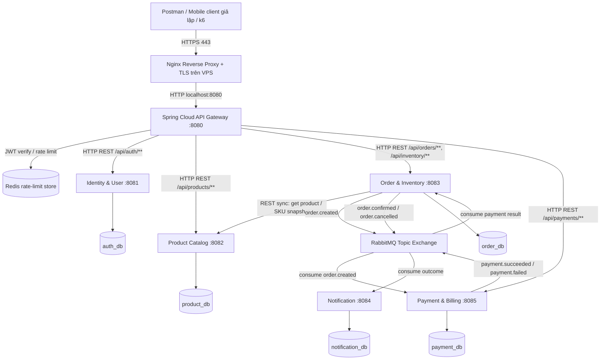
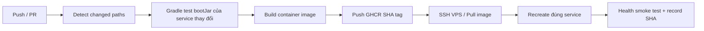

# KẾ HOẠCH PHÁT TRIỂN OMNICHANNEL E-COMMERCE — CÓ API GATEWAY

> **Phiên bản tài liệu:** 2.0 — điều chỉnh theo toàn bộ [đề gốc](https://github.com/hunghx/Project-MD5---Devops/blob/main/De_Tai_1_Omnichannel_ECommerce.md), sơ đồ kiến trúc và trạng thái GitHub thực tế ngày 11/10/2026.  
> **Cập nhật thực thi:** `main` đã có mốc `00–10`, SSH và HTTPS Auth đã kiểm chứng. Gateway bắt đầu từ `11`. Các số mốc `09–26` trong bảng gốc bên dưới chỉ là tham khảo thứ tự công việc; khi thực thi cấp số tăng dần theo Git, kể cả commit sửa lỗi và merge PR. Người dùng không giới hạn số lần commit. CI/CD cho service mới được bổ sung ngay ngày 1 để deploy sau khi PR đạt kiểm thử.
> **Repo làm bài:** https://github.com/dth251/md05-rikkei-project.git (nhánh `main`, public).  
> **Thời gian:** 1 thành viên, 3 ngày làm việc tập trung; triển khai tăng dần từng service.  
> **Công nghệ:** Java 21, Spring Boot 3.5.6, **Gradle Groovy `build.gradle`**, **Spring Cloud Gateway 2025.0.x**, PostgreSQL, RabbitMQ, Redis (chỉ để rate limit Gateway), JWT, Nginx, Docker Compose, GitHub Actions, k6.  
> **Không dùng:** Frontend, Maven/`pom.xml`, Gradle Kotlin DSL, Flyway, Liquibase, module/thư mục `shared`, `bootstrap.yml`, `bootstrap.properties`, Bootstrap UI hoặc lớp bootstrap dữ liệu.  
> **Kiến trúc mục tiêu:** **6 ứng dụng Java độc lập** = **01 API Gateway** + **05 business microservices** (Auth, Product, Order/Inventory, Payment, Notification). Nginx reverse proxy nằm ngoài cùng trên VPS.  
> **Deployment:** VPS `azvps-1789407659`, IP `42.96.2.60`, domain `md05-rikkei-project.duckdns.org`, đường dẫn VPS `/opt/omnichannel-ecommerce`.

> **Bảo mật quan trọng:** Tuyệt đối không ghi mật khẩu DB, SSH, JWT, RabbitMQ hoặc deploy key vào Markdown, `.env.example`, commit, GitHub Actions log. Các mật khẩu từng cung cấp trong hội thoại nên được **đổi/thu hồi**; dùng `.env` riêng trên VPS (`chmod 600`), SSH key và tài khoản `deploy` thay cho đăng nhập root về lâu dài.

---

## 0. KẾT QUẢ ĐỐI CHIẾU TOÀN BỘ ĐỀ GỐC

| Yêu cầu của đề | Thiết kế chuẩn trong đề | Cách triển khai 3 ngày | Ưu tiên / mức đáp ứng |
|---|---|---|---|
| API Gateway | Nginx/Kong/**Spring Cloud Gateway**: **JWT verification, rate limiting, routing** | **Spring Cloud Gateway WebFlux riêng port 8080**; Redis rate limit; Nginx chỉ terminate HTTPS | **P0 — bắt buộc bổ sung** |
| Identity & User | JWT issue/refresh, user, role, địa chỉ | Auth JWT, register/login, roles; refresh token/địa chỉ mở rộng sau | P0 lõi / P1 mở rộng |
| Product Catalog | SKU, danh mục, thương hiệu, biến thể; MongoDB + Elasticsearch gợi ý | PostgreSQL + JPA, SKU, CRUD, dữ liệu đủ cho đặt hàng; Elastic tìm kiếm nâng cao bỏ | P0 lõi / P2 Elastic |
| Order & Inventory | Đơn hàng, reserve stock, chống race, flash sale | Order DB, transaction + atomic UPDATE; **không cần Redis Lock** do đề cho phép SQL locks | **P0** |
| Payment & Billing | Cổng thanh toán thật, webhook, refund | Payment service, payment mock PENDING/SUCCESS/FAILED; order compensate; webhook/đối soát giả lập nếu kịp | P0 mock / P2 gateway thật |
| Notification | Email/SMS/push | RabbitMQ consumer lưu log; có thể dùng SMTP test nếu kịp | P0 async / P1 email |
| Giao tiếp đồng bộ | Gateway→service HTTP; Order→Product gRPC | Gateway HTTP REST, Order→Product REST **là giản lược so với sơ đồ gRPC** | P0 REST / P2 gRPC |
| RabbitMQ/Kafka | OrderCreated, Payment result, consumers | RabbitMQ exchange `commerce.events`, durable queues, event id | **P0** |
| DDD/API-first | Bounded contexts, snapshot OrderItem, Swagger/OpenAPI | 5 bounded context, database/schema ownership, `docs/api-contract.md`, DTO chuẩn | **P0** |
| Saga | Thanh toán thất bại phải trả kho | Choreography: Payment FAILED → Order CANCELLED + release inventory | **P0** |
| Outbox | Không mất event khi DB commit nhưng MQ fail | Thêm transactional outbox cho Order/Payment nếu kịp; nếu chưa có phải nêu là giới hạn | **P1** |
| Database per service | Không truy vấn chéo DB | 1 PostgreSQL instance, **5 DB và 5 DB users** | **P0** |
| VPS & security | Docker, Nginx SSL, UFW, domain, private DB ports | Docker Compose, Nginx → Gateway, Certbot HTTPS, firewall, volumes | **P0** |
| CI/CD | Push main → build image → registry → VPS deploy | GitHub Actions Gradle test/build, GHCR, deploy **đúng service thay đổi** | **P0/P1** |
| Observability | Loki/Promtail, Prometheus/Grafana, Jaeger/Zipkin | JSON logs + Actuator/Micrometer trước; full stack nếu còn thời gian | P1/P2 |
| k6 và failure demo | 500–1000 requests/s, không âm kho, tắt service khác vẫn sống | k6 đo tốc độ thật, 100 requests tranh 1 stock, tắt Notification/Payment | **P0** |

**Phân biệt:** `P0` = cần để trình diễn bài, `P1` = thêm khi P0 ổn, `P2` = phạm vi doanh nghiệp trong đề nhưng khó hoàn thành trong 3 ngày. Không được nói “đáp ứng đầy đủ đề” nếu chưa có các mục P1/P2 được đề mô tả. Mục tiêu 500–1000 RPS là **mức cần thử**, không phải tuyên bố hệ thống đã đạt.

---

## 1. TRẠNG THÁI THỰC TẾ CỦA REPOSITORY (KHÔNG TẠO LẠI)

Đã kiểm tra repository công khai `dth251/md05-rikkei-project` nhánh `main`:

- Trước khi triển khai kế hoạch mới, `main` đã có commit `00–10`, mới nhất `9aa11c4` (`10-docs: integrate verified vps and https deployment record`). Auth trên VPS đang dùng image SHA `5f441d2c5c85de10d0d68dcbf02a38952937c6d7`.
- Đã có `auth-service/` (Gradle Groovy), PostgreSQL, RabbitMQ, `docker-compose.yml`, các file CI/CD và cấu hình Nginx **trỏ thẳng Auth** ở giai đoạn đầu.
- `docker-compose.yml` hiện mới khai báo PostgreSQL, RabbitMQ, RabbitMQ topology và Auth; **chưa có `api-gateway` hay Redis**, chưa có 4 business services còn lại.
- SSH bằng khóa và HTTPS domain Auth đã kiểm chứng; [CI/CD run](https://github.com/dth251/md05-rikkei-project/actions/runs/38132486801) verify/publish/deploy đạt. Gateway và các service mới chỉ được ghi deployed sau khi có kiểm chứng riêng.

**Quyết định bắt buộc:** Không sửa, rebase hoặc đánh số lại lịch sử `00–10`. **Gateway bắt đầu từ `11-api-gateway`**. Khi phát triển, kiểm tra `git log --oneline -10` trước khi cấp số mới; phát triển trên `feature/...` và tích hợp bằng PR sau khi kiểm thử đạt, không push thẳng `main` theo các ví dụ cũ bên dưới.

---

## 2. SƠ ĐỒ KIẾN TRÚC ĐÚNG ĐỀ GỐC, CÓ API GATEWAY RIÊNG



**Phân vai chính xác**:

1. **Nginx trên VPS**: nhận HTTP/HTTPS từ ngoài, redirect 80→443, TLS Let's Encrypt, chuyển **tất cả `/api/**` chỉ tới Gateway `127.0.0.1:8080`**. Không còn Nginx route trực tiếp tới Auth/Product/Order/Payment.
2. **Spring Cloud API Gateway**: ứng dụng Java độc lập với Gradle Groovy; verify JWT, phân quyền bước đầu, rate limit bằng Redis, route các API và health/metrics. **Không chứa nghiệp vụ, không có PostgreSQL và không có `shared`**.
3. **Business services**: tự quản lý nghiệp vụ và DB; nên kiểm tra JWT/role ở service cho defense-in-depth, đặc biệt quản trị sản phẩm/hoàn tiền. Không tin một header `X-User-Id` do client có thể tự điền.
4. **RabbitMQ**: giao tiếp event-driven; Notification **không cần route public từ Gateway**. Các service publish/consume trong Docker internal network.
5. **Redis chỉ cho Gateway rate limiting**. Giữ kho bằng atomic SQL được đề gốc cho phép thay cho Redis distributed lock.

### 2.1. Bảng port và trách nhiệm

| Thành phần | Internal port | Expose public? | DB / vai trò |
|---|---:|---|---|
| Nginx host | 80, 443 | **Có** | TLS/reverse proxy |
| `api-gateway` | 8080 | **Không** — bind host `127.0.0.1:8080` | JWT, routing, Redis rate limit |
| `auth-service` | 8081 | Không | `auth_db` |
| `product-service` | 8082 | Không | `product_db` |
| `order-service` | 8083 | Không | `order_db` |
| `notification-service` | 8084 | Không | `notification_db` |
| `payment-service` | 8085 | Không | `payment_db` |
| `postgres` | 5432 | Không | 5 DB độc lập |
| `rabbitmq` | 5672, 15672 | Không | Exchange/queues |
| `redis` | 6379 | Không | Token bucket counters |

Trong 1–2 ngày đầu có thể tạm bind service debug qua `127.0.0.1` cho test trên VPS, nhưng **client/demo vẫn luôn đi qua Gateway** sau khi Gateway hoạt động. Production không publish service nội bộ ra `0.0.0.0`.

### 2.2. Gateway routing contract

| Client request | URI nội bộ Gateway forward | Auth |
|---|---|---|
| `POST /api/auth/register` | `http://auth-service:8081` | Public |
| `POST /api/auth/login` | `http://auth-service:8081` | Public, rate limit nghiêm |
| `GET /api/auth/me` | `http://auth-service:8081` | JWT |
| `GET /api/products/**` | `http://product-service:8082` | Public |
| `POST/PUT/DELETE /api/products/**` | `http://product-service:8082` | JWT, ADMIN kiểm tra tại service |
| `/api/orders/**` | `http://order-service:8083` | JWT |
| `/api/inventory/**` | `http://order-service:8083` | JWT / ADMIN nếu nhập kho |
| `/api/payments/**` | `http://payment-service:8085` | JWT; simulate chỉ ADMIN + demo |

**Giữ nguyên prefix URL** `/api/...` khi forward để không phải sửa controller đang dùng; **không thêm `StripPrefix`** nếu backend hiện map các path đầy đủ. `api-gateway` chạy trên WebFlux, vì vậy **không thêm `spring-boot-starter-web`** hoặc Spring Data JPA trong Gateway.

### 2.3. Bảo mật qua hai tầng

- Gateway nhận `Authorization: Bearer <JWT>`, xác minh signature, `exp`, `iss=omnichannel-auth` và chuyển request hợp lệ vào backend.
- Dùng cùng thuật toán và bí mật ký JWT thực tế mà Auth đang dùng; lấy bằng biến môi trường `JWT_SECRET` trên VPS. Không viết lại thuật toán JWT tùy ý.
- Không công khai Gateway 8080, chỉ Nginx được truy cập. Nginx **ghi đè** `X-Real-IP`, `X-Forwarded-For` từ `$remote_addr`; Gateway chỉ tin forwarded header từ proxy đã kiểm soát.
- Redis token bucket route riêng cho login và Order. Kiểm thử `429 Too Many Requests` với tải vượt cấu hình; chính sách login cần độc lập với đơn hàng.
- Trả `401` khi không có/không hợp lệ token ở endpoint protected, `403` khi role không đủ (service phụ trách), `502/503` khi backend không sẵn sàng và `429` khi vượt quota.
- Không public `/actuator/gateway`, `/actuator/env`, Redis Management, RabbitMQ Management hoặc test payment-admin endpoint chưa khóa.

---

## 3. CẤU TRÚC CODEBASE 6 ỨNG DỤNG — KHÔNG `shared`, KHÔNG `bootstrap`

```text
md05-rikkei-project/
├── api-gateway/                          # MỚI: Spring Cloud Gateway (Gradle Groovy)
│   ├── src/main/java/com/app/gateway/
│   │   ├── ApiGatewayApplication.java
│   │   ├── config/
│   │   │   ├── GatewaySecurityConfig.java
│   │   │   ├── JwtDecoderConfig.java
│   │   │   └── RateLimitKeyResolver.java
│   │   └── web/
│   │       └── GatewayErrorHandler.java
│   ├── src/main/resources/application.yml
│   ├── src/test/java/com/app/gateway/
│   ├── gradle/wrapper/
│   ├── gradlew
│   ├── gradlew.bat
│   ├── build.gradle
│   ├── settings.gradle
│   └── Dockerfile.runtime
├── auth-service/                         # HIỆN CÓ, giữ nguyên package/module riêng
│   └── src/main/java/com/app/auth/{controller,service,repository,entity,dto,security,web}/
├── product-service/
│   └── src/main/java/com/app/product/{controller,service,repository,entity,dto,security,web}/
├── order-service/
│   └── src/main/java/com/app/order/{controller,service,repository,entity,dto,client,messaging,security,web}/
├── payment-service/
│   └── src/main/java/com/app/payment/{controller,service,repository,entity,dto,messaging,security,web}/
├── notification-service/
│   └── src/main/java/com/app/notification/{messaging,service,repository,entity,config}/
├── infrastructure/
│   ├── postgres/init-databases.sh
│   ├── rabbitmq/definitions.json
│   ├── nginx/gateway.conf.template        # MỚI, thay Nginx direct-to-Auth
│   └── scripts/
├── docs/
│   ├── architecture.md
│   ├── api-contract.md
│   ├── coding-conventions.md
│   ├── commits-and-deployments.md
│   ├── gateway-test-results.md
│   └── test-results.md
├── tests/
│   ├── postman/
│   └── k6/{gateway-rate-limit.js,race-condition.js,load-test.js}
├── .github/workflows/
├── docker-compose.yml
├── docker-compose.local.yml
├── docker-compose.production.yml
├── .env.example
├── .gitignore
└── README.md
```

- Mỗi ứng dụng sở hữu `build.gradle`, `settings.gradle`, Gradle Wrapper, Application class, config/security/exception/DTO **riêng**. Không tồn tại `shared/`, Java common module, Maven hay Flyway.
- Trong tài liệu cây thư mục dùng dấu `{...}` để viết gọn cho sơ đồ; **khi tạo file thật phải tạo từng thư mục theo đúng Java package**, không tạo thư mục tên `{controller,...}`.
- `ApiGatewayApplication.java` sử dụng `@SpringBootApplication` (đây là entry point chuẩn của Spring Boot, **không phải** module `bootstrap` mà bạn muốn loại bỏ).

---

## 4. CẤU HÌNH API GATEWAY — GRADLE GROOVY, KHÔNG MAVEN

Spring Boot đang dùng phiên bản `3.5.6`; Spring Cloud release train tương ứng là **`2025.0.x`**. Đối với bản Gateway WebFlux 2025, sử dụng artifact **`spring-cloud-starter-gateway-server-webflux`** và prefix cấu hình **`spring.cloud.gateway.server.webflux`**.

### 4.1. `api-gateway/build.gradle` (tham khảo)

```groovy
plugins {
    id 'java'
    id 'org.springframework.boot' version '3.5.6'
    id 'io.spring.dependency-management' version '1.1.7'
}

group = 'com.app'
version = '0.0.1-SNAPSHOT'

java {
    toolchain {
        languageVersion = JavaLanguageVersion.of(21)
    }
}

ext {
    set('springCloudVersion', '2025.0.1')
}

repositories {
    mavenCentral()
}

dependencies {
    implementation 'org.springframework.cloud:spring-cloud-starter-gateway-server-webflux'
    implementation 'org.springframework.boot:spring-boot-starter-security'
    implementation 'org.springframework.boot:spring-boot-starter-oauth2-resource-server'
    implementation 'org.springframework.boot:spring-boot-starter-data-redis-reactive'
    implementation 'org.springframework.boot:spring-boot-starter-actuator'

    testImplementation 'org.springframework.boot:spring-boot-starter-test'
    testImplementation 'io.projectreactor:reactor-test'
}

dependencyManagement {
    imports {
        mavenBom "org.springframework.cloud:spring-cloud-dependencies:${springCloudVersion}"
    }
}

tasks.named('test') {
    useJUnitPlatform()
}
```

Ghi chú: chọn bản patch mới nhất đã kiểm chứng trong nhánh tương thích `2025.0.x` nếu có; không nâng riêng Gateway lên Spring Boot 4.x khi 5 service còn dùng 3.5.6. **Không** thêm `spring-boot-starter-web`, `spring-boot-starter-data-jpa`, PostgreSQL driver hoặc RabbitMQ vào Gateway.

### 4.2. `api-gateway/src/main/resources/application.yml` (khung cấu hình)

```yaml
server:
  port: 8080

spring:
  application:
    name: api-gateway

  data:
    redis:
      host: ${REDIS_HOST:redis}
      port: 6379

  cloud:
    gateway:
      server:
        webflux:
          routes:
            - id: auth-service
              uri: http://auth-service:8081
              predicates:
                - Path=/api/auth/**

            - id: product-service
              uri: http://product-service:8082
              predicates:
                - Path=/api/products/**

            - id: order-service
              uri: http://order-service:8083
              predicates:
                - Path=/api/orders/**,/api/inventory/**

            - id: payment-service
              uri: http://payment-service:8085
              predicates:
                - Path=/api/payments/**

management:
  endpoints:
    web:
      exposure:
        include: health,info,prometheus

jwt:
  secret: ${JWT_SECRET}
  issuer: omnichannel-auth
```

Tách cấu hình `RequestRateLimiter` theo route riêng khi viết Gateway:

- `auth-login`: predicate `Path=/api/auth/login` kết hợp `Method=POST`, đặt **trước** route rộng `/api/auth/**`; ví dụ `replenishRate=2`, `burstCapacity=5` trên mỗi client key.
- `order`: `/api/orders/**` ví dụ `replenishRate=20`, `burstCapacity=40`; các số chỉ để demo, phải điều chỉnh khi k6.
- Các route khác không cần áp dụng cùng hạn mức với login.
- Sử dụng `RequestRateLimiter` mặc định của Spring Cloud Gateway với RedisRateLimiter; implement bean `KeyResolver` trong `com.app.gateway.config` để lấy subject JWT hoặc IP do **Nginx đã kiểm soát**. Tránh dùng tất cả client chung một key `anonymous`.
- Thêm **gateway global/default filter** cho correlation/request ID, timeout connect/response để tránh treo khi service down.
- Lưu ý cấu hình trên là khung routing, **chưa tự bật JWT verification hoặc rate limiting**; hai phần này phải có Security config + filter và kiểm thử thực tế ở các mốc commit bên dưới.

### 4.3. Cách tổ chức Java rõ dòng (theo ảnh yêu cầu)

```java
package com.app.gateway.config;

import org.springframework.context.annotation.Bean;
import org.springframework.context.annotation.Configuration;
import org.springframework.security.config.web.server.ServerHttpSecurity;
import org.springframework.security.web.server.SecurityWebFilterChain;

@Configuration
public class GatewaySecurityConfig {

    @Bean
    public SecurityWebFilterChain securityWebFilterChain(
            ServerHttpSecurity http
    ) {
        return http
                .csrf(ServerHttpSecurity.CsrfSpec::disable)
                .authorizeExchange(exchange -> exchange
                        .pathMatchers(
                                "/api/auth/register",
                                "/api/auth/login",
                                "/actuator/health"
                        )
                        .permitAll()
                        .pathMatchers(
                                org.springframework.http.HttpMethod.GET,
                                "/api/products/**"
                        )
                        .permitAll()
                        .anyExchange()
                        .authenticated()
                )
                .oauth2ResourceServer(oauth2 -> oauth2.jwt(
                        org.springframework.security.config.Customizer.withDefaults()
                ))
                .build();
    }
}
```

**Quan trọng:** Ví dụ này chỉ là **khung SecurityWebFilterChain**. Cần thêm `ReactiveJwtDecoder` phù hợp thuật toán ký thực tế của Auth và validator `iss/exp`; nếu không, Gateway sẽ không xác thực token đúng. Role ADMIN vẫn phải kiểm tra tại service; Gateway không thay thế toàn bộ service security. Cấu hình header/identity phải chống spoofing.

### 4.4. Compose bổ sung (không ghi mật khẩu vào YAML)

Ví dụ phần cấu hình cần **thêm vào** `docker-compose.yml`, điều chỉnh để phù hợp file hiện có:

```yaml
services:
  redis:
    image: redis:7-alpine
    restart: unless-stopped
    volumes:
      - redis-data:/data
    command:
      - redis-server
      - --appendonly
      - "yes"
    healthcheck:
      test:
        - CMD
        - redis-cli
        - ping
      interval: 10s
      timeout: 3s
      retries: 10

  api-gateway:
    build:
      context: ./api-gateway
      dockerfile: Dockerfile.runtime
    restart: unless-stopped
    environment:
      JWT_SECRET: ${JWT_SECRET:?Set JWT_SECRET}
      REDIS_HOST: redis
    ports:
      - "127.0.0.1:8080:8080"
    depends_on:
      redis:
        condition: service_healthy
    healthcheck:
      test:
        - CMD
        - wget
        - -q
        - --spider
        - http://127.0.0.1:8080/actuator/health
      interval: 10s
      timeout: 5s
      retries: 10

volumes:
  redis-data:
```

**Cảnh báo trước khi copy:** Repo hiện dùng `Dockerfile.runtime` build từ JAR đã được Gradle kiểm thử trước. Phải build `./gradlew clean test bootJar` trước khi `docker compose build api-gateway`; runtime image phải có `wget` nếu muốn dùng healthcheck như trên. Compose fragment chỉ mang tính hướng dẫn ghép vào file, không thay cả file hiện có. `Redis` không expose `6379` ra host; mọi service dùng chung Docker internal network.

---

## 5. NGINX HOST PHẢI FORWARD QUA API GATEWAY, KHÔNG QUA BUSINESS SERVICE

Repo hiện có `infrastructure/nginx/auth.conf.template` phục vụ Auth trực tiếp. **Không xóa cấu hình đang hoạt động trước khi Gateway healthy.** Tạo bản `infrastructure/nginx/gateway.conf.template`, kiểm tra Nginx rồi mới chuyển.

```nginx
server {
    listen 80;
    server_name md05-rikkei-project.duckdns.org;

    location /api/ {
        proxy_pass http://127.0.0.1:8080;
        proxy_http_version 1.1;
        proxy_set_header Host $host;
        proxy_set_header X-Real-IP $remote_addr;
        proxy_set_header X-Forwarded-For $remote_addr;
        proxy_set_header X-Forwarded-Proto $scheme;
        proxy_connect_timeout 5s;
        proxy_read_timeout 30s;
    }

    location / {
        return 404;
    }
}
```

1. Khi Gateway `UP`, test route qua `http://127.0.0.1:8080/api/auth/...` ngay trên VPS (hoặc từ máy local khi phát triển).
2. Sau đó thay upstream Nginx trực tiếp Auth bằng upstream `127.0.0.1:8080`. Chạy `nginx -t` trước `systemctl reload nginx`.
3. Cấp/gia hạn Certbot cho `md05-rikkei-project.duckdns.org` **sau khi DNS A trỏ đúng `42.96.2.60`**. Certbot sẽ chỉnh server block HTTPS. Giữ HTTPS redirect, không kết thúc ở HTTP.
4. **Không forward toàn bộ `/actuator/**` ra Internet**. Muốn health public cho demo, tạo endpoint `/gateway-status` chỉ trả trạng thái tối thiểu hoặc test health nội bộ qua SSH.
5. SSH (cổng đã cấu hình), 80, 443 là các cổng cần được xét mở; PostgreSQL, RabbitMQ, Redis, business service không được public. Thận trọng khi kích hoạt UFW để không khóa SSH.

Các lệnh riêng từng dòng:

```bash
ssh root@42.96.2.60
```

Sau khi đã có quyền vào VPS, chạy trong terminal VPS:

```bash
cd /opt/omnichannel-ecommerce
git pull --ff-only origin main
docker compose config
nginx -t
systemctl reload nginx
curl -i http://127.0.0.1:8080/api/products
```

`GET /api/products` sẽ trả `502/503` nếu Product chưa được deploy; trong giai đoạn Gateway skeleton hãy test `/actuator/health` trực tiếp ở loopback trước. Không coi 503 là lỗi routing khi upstream chưa tồn tại.

---

## 6. LUỒNG BUSINESS & EVENTS THEO KIẾN TRÚC GỐC

### 6.1. RabbitMQ exchange và durable queues (provision trước Order)

| Exchange | Durable Queue | Routing key | Consumer |
|---|---|---|---|
| `commerce.events` | `payment.order-created.q` | `order.created` | Payment |
| `commerce.events` | `order.payment-result.q` | `payment.succeeded`, `payment.failed` | Order |
| `commerce.events` | `notification.order.q` | `order.confirmed`, `order.cancelled` | Notification |

Nếu consumer chưa có nhưng queue đã bind, event được giữ để xử lý sau. Publisher gửi persistent message, consumer ACK sau khi xử lý DB và dùng `event_id UNIQUE`. Cần publisher confirm/returns hoặc Outbox để không nhầm “đã publish” khi message chưa đến broker.

### 6.2. Event/Saga choreography

```mermaid
sequenceDiagram
    participant C as Client
    participant G as API Gateway
    participant O as Order
    participant R as RabbitMQ
    participant P as Payment
    participant N as Notification

    C->>G: POST /api/orders + JWT
    G->>O: REST authorized request
    O->>O: Atomic reserve stock + save PENDING_PAYMENT
    O-->>R: order.created
    R-->>P: order.created
    P->>P: Create payment PENDING
    P-->>R: payment.succeeded / payment.failed
    R-->>O: Payment result
    alt succeeded
        O->>O: CONFIRMED; reserved -= qty
        O-->>R: order.confirmed
    else failed
        O->>O: CANCELLED; reserved -= qty; available += qty
        O-->>R: order.cancelled
    end
    R-->>N: final order state
    N->>N: Log notification once
```

**Transaction boundary:** `@Transactional` chỉ ràng buộc `order_db`, không phủ `payment_db` và RabbitMQ. Bảng Outbox trong **DB của publisher** + relay scheduler là hướng đúng để chống mất event. Ưu tiên làm cho Order trước; Payment cũng nên có Outbox nếu còn thời gian. Nếu làm bản mock không Outbox, ghi rõ rủi ro crash giữa DB commit và publish.

### 6.3. Chống Race Condition

```sql
UPDATE inventory
SET available = available - :quantity,
    reserved = reserved + :quantity
WHERE product_id = :productId
  AND available >= :quantity;
```

- Câu UPDATE và insert Order/OrderItem chạy trong **một local DB transaction**. Khi `updated_rows = 0` trả 409.
- Kết quả payment chỉ áp dụng **một lần** nếu Order đang ở `PENDING_PAYMENT`; chống confirm/cancel hai lần, kể cả message duplicate.
- `idempotency_key` duy nhất theo user/request đặt hàng; OrderItem lưu snapshot `SKU, name, unit_price`.
- `channel=WEB` hoặc `POS`, hai nguồn dùng chung `inventory` (mô phỏng omnichannel không cần Frontend).

---

## 7. KẾ HOẠCH 3 NGÀY THEO MỐC COMMIT THỰC TẾ: BẮT ĐẦU TỪ `09`

**Vòng lặp cho mỗi mốc:** tạo code độc lập → `./gradlew test bootJar` → Docker build/test → **commit đúng thứ tự** → push → VPS `git pull --ff-only` → deploy đúng service → kiểm tra health/log → ghi commit SHA và trạng thái vào `docs/commits-and-deployments.md`.

### NGÀY 1 — Gateway trước, sau đó Product + Order skeleton (10–12 giờ)

| Giờ ước tính | Mốc | Đầu ra phải có | Commit |
|---|---|---|---|
| 08:00–09:30 | API Gateway skeleton + routes + Actuator | `api-gateway` build, health `UP`, route Auth qua port 8080 | `09-api-gateway` |
| 09:30–11:30 | Redis + JWT verify + route rate limits | JWT 401/valid; request quá hạn trả 429 | `10-api-gateway` |
| 11:30–12:30 | Nginx → Gateway + repo scripts/CI chỉnh smoke | Chỉ Nginx → Gateway, test 1 Auth route | `11-infrastructure` |
| 13:30–15:00 | Product skeleton Gradle | Product health; DB `product_db` | `12-product-service` |
| 15:00–17:30 | Product CRUD, role ADMIN | API GET/POST/PUT/soft-delete | `13-product-service` |
| 19:00–21:00 | Order skeleton, Entity, `order_db` | health, bảng Order/Inventory | `14-order-service` |

**Nếu chậm:** giữ Gateway + Product chạy được; Order skeleton có thể dời đầu ngày 2. Không rút gọn Gateway thành Nginx trực tiếp.

### NGÀY 2 — Order → Payment → Notification (11–12 giờ)

| Giờ ước tính | Mốc | Đầu ra | Commit |
|---|---|---|---|
| 08:00–11:00 | Order API + SQL reserve + idempotency | WEB/POS, 409 khi hết kho | `15-order-service` |
| 11:00–12:00 | `order.created` RabbitMQ | event vào durable queue | `16-order-service` |
| 13:00–14:00 | Payment skeleton | Payment health và `payment_db` | `17-payment-service` |
| 14:00–16:00 | Payment consume + simulate | PENDING → SUCCESS/FAILED; publish result | `18-payment-service` |
| 16:00–17:30 | Order consume payment result | CONFIRMED hoặc CANCELLED + hoàn kho | `19-order-service` |
| 17:30–18:15 | Notification skeleton | Notification health | `20-notification-service` |
| 19:00–21:00 | Notification consume + idempotency | Notification DB ghi một lần; E2E chạy | `21-notification-service` |

**Nếu chậm:** hoàn thành Order + Payment + compensation trước; Notification consumer có thể làm cuối ngày 2 hoặc đầu ngày 3, nhưng vẫn phải có để demo RabbitMQ. Không bỏ Payment.

### NGÀY 3 — GitHub Actions, VPS HTTPS, kiểm thử, báo cáo (10–12 giờ)

| Giờ ước tính | Mốc | Đầu ra | Commit |
|---|---|---|---|
| 08:00–10:00 | Hoàn thiện Compose prod, SSL, UFW, rollback | Domain HTTPS qua Gateway; DB/MQ/Redis private | `22-infrastructure` |
| 10:00–12:00 | CI/CD Gradle + GHCR + selective deploy Gateway/service | CI xanh; image tagged SHA; deploy theo service | `23-devops` |
| 13:00–15:00 | k6, Postman, JWT 401/403, rate limit 429 | Báo cáo gateway + nghiệp vụ | `24-testing` |
| 15:00–17:00 | Race, failure/recovery, Saga compensation | Lưu logs và kết quả thực tế | `25-testing` |
| 19:00–21:00 | README, sơ đồ Mermaid, API Contract, video demo | Bài nộp đủ bằng chứng | `26-docs` |

**Tính khả thi:** Đây là kế hoạch tham vọng cho 1 người/3 ngày; nếu thiếu thời gian, bỏ Elasticsearch, gRPC, email thật, tracing/UI monitoring trước, nhưng **không bỏ API Gateway, 5 service, RabbitMQ, payment mock và kho chính xác**. Nếu mục P0 chưa kịp chạy online, ghi rõ demo local và tiêu chí chưa đạt; không tự nhận triển khai VPS thành công.

---

## 8. BẢNG COMMIT TIẾP NỐI LỊCH SỬ, KHÔNG ĐÁNH SỐ LẠI

| Số | Commit message đề xuất | Push / deploy riêng |
|---:|---|---|
| 00–08 | **ĐÃ CÓ** trong lịch sử `main`, không chỉnh sửa | Hạ tầng/Auth/CI ban đầu |
| 09 | `09-api-gateway: initialize gradle webflux routes and health` | Deploy `api-gateway` |
| 10 | `10-api-gateway: add jwt verification redis rate limiting and tests` | Deploy `redis`, `api-gateway` |
| 11 | `11-infrastructure: route nginx traffic through api gateway` | Deploy/test Nginx upstream, sửa scripts |
| 12 | `12-product-service: initialize gradle application and database` | Deploy `product-service` |
| 13 | `13-product-service: implement product catalog crud and jwt roles` | Redeploy `product-service` |
| 14 | `14-order-service: initialize gradle order entities and inventory` | Deploy `order-service` |
| 15 | `15-order-service: implement atomic reservation and idempotent orders` | Redeploy `order-service` |
| 16 | `16-order-service: publish order created events through rabbitmq` | Redeploy `order-service` |
| 17 | `17-payment-service: initialize gradle app and payment database` | Deploy `payment-service` |
| 18 | `18-payment-service: consume orders and publish mock payment outcomes` | Redeploy `payment-service` |
| 19 | `19-order-service: confirm payment and compensate failed inventory` | Redeploy `order-service` |
| 20 | `20-notification-service: initialize gradle app and health endpoint` | Deploy `notification-service` |
| 21 | `21-notification-service: consume outcomes and persist notifications` | Redeploy `notification-service` |
| 22 | `22-infrastructure: secure gateway nginx tls and production compose` | Nginx/VPS config |
| 23 | `23-devops: extend gradle ci cd to gateway and selective services` | Workflow/registry/deploy |
| 24 | `24-testing: verify gateway jwt routing and redis rate limits` | Test, không cần redeploy |
| 25 | `25-testing: verify race conditions saga and service recovery` | Test, không cần redeploy |
| 26 | `26-docs: finalize architecture api contracts and demo evidence` | Tài liệu |

Số commit là **mốc dự kiến**; nếu sinh thêm commit sửa lỗi thì phải lấy số tiếp theo chưa dùng, cập nhật bảng, tránh giả định cố định sau khi lịch sử Git đã phát sinh commit mới. Theo `AGENTS.md` của repo, ưu tiên làm `feature/...` branch và PR đã test; nếu thực sự push thẳng `main` thì bảo đảm CI đạt và không force-push.

### 8.1. Lệnh local cho API Gateway — mỗi câu lệnh một dòng

Trên terminal local, sau khi đã clone repo:

```bash
cd md05-rikkei-project
cd api-gateway
./gradlew clean test bootJar --no-daemon
cd ..
docker compose build api-gateway
docker compose up -d redis
docker compose up -d --no-deps api-gateway
docker compose ps api-gateway
```

Commit/push (sau khi kiểm thử xong mốc `09`):

```bash
git status
git add api-gateway
git add docker-compose.yml
git commit -m "09-api-gateway: initialize gradle webflux routes and health"
git push origin main
```

Đến mốc `10`, dùng `git add api-gateway` và **commit mới `10-...`**, không sửa commit cũ.

**Chú ý Windows:** dùng `./gradlew` trong Bash/Git Bash, hoặc `./gradlew.bat`/` .\gradlew.bat` trong PowerShell/CMD (lệnh PowerShell thông thường: `.\gradlew.bat clean test bootJar --no-daemon`).

### 8.2. Pull + deploy đúng API Gateway trên VPS

Chỉ chạy khi có SSH key/permission hợp lệ, `.env` đã được cấu hình và đã build hoặc pull đúng image. Các lệnh sau minh họa **build từ source trên VPS**; nếu `Dockerfile.runtime` chỉ copy JAR thì **phải có JAR trước**, ưu tiên CI/CD GHCR để không cần build Gradle trên VPS.

```bash
ssh deploy@42.96.2.60
```

Trong terminal VPS:

```bash
cd /opt/omnichannel-ecommerce
git pull --ff-only origin main
docker compose up -d redis
docker compose up -d --build --no-deps api-gateway
docker compose ps api-gateway
docker compose logs --tail=100 api-gateway
curl -i http://127.0.0.1:8080/actuator/health
curl -i http://127.0.0.1:8080/api/auth/me
```

`/api/auth/me` không có token **kỳ vọng 401**, không phải phải trả 200. Khi Product chưa tồn tại, `/api/products` có thể trả 503, vẫn phải kiểm chứng route map trước khi coi đó là lỗi. Không chạy các lệnh deploy như thể VPS đã được cấp quyền và đang sẵn sàng; kiểm chứng thực tế trước.

### 8.3. Lệnh deploy độc lập các service còn lại

Sau khi commit/push và `git pull` trên VPS, chạy **riêng** service đang phát triển:

```bash
docker compose up -d --build --no-deps product-service
```

```bash
docker compose up -d --build --no-deps order-service
```

```bash
docker compose up -d --build --no-deps payment-service
```

```bash
docker compose up -d --build --no-deps notification-service
```

Chỉ sử dụng `--no-deps` nếu PostgreSQL/RabbitMQ/Redis tương ứng đã up và healthy; khi chuyển sang GHCR images, dùng `docker compose pull service` và `docker compose up -d --no-deps service`, **không** dùng `--build` cho image registry deploy.

---

## 9. API CONTRACT TỐI THIỂU CẦN KIỂM THỬ QUA GATEWAY

| Service | API từ phía client (HTTPS domain → Nginx → Gateway) | Quyền |
|---|---|---|
| Auth | `POST /api/auth/register` | Public |
| Auth | `POST /api/auth/login` | Public + rate limit |
| Auth | `GET /api/auth/me` | JWT |
| Product | `GET /api/products`, `GET /api/products/{id}` | Public |
| Product | `POST /api/products`, `PUT /api/products/{id}`, `DELETE /api/products/{id}` | ADMIN |
| Order | `POST /api/orders`, `GET /api/orders/{id}` | USER/ADMIN |
| Order | `GET /api/inventory/{productId}`, `POST /api/inventory/stocks` | Auth / ADMIN cho nhập kho |
| Payment | `GET /api/payments/{id}`, `GET /api/payments/by-order/{orderId}` | Chủ đơn/ADMIN |
| Payment | `POST /api/payments/{id}/simulate` | Chỉ ADMIN / demo |
| Gateway | `GET /actuator/health` | **Chỉ local/internal**, không Nginx publish |

Một mẫu request Java **đúng định dạng nhiều dòng** (không gộp annotation/record một dòng):

```java
package com.app.auth.dto;

import jakarta.validation.constraints.Email;
import jakarta.validation.constraints.NotBlank;
import jakarta.validation.constraints.Size;

public record RegisterRequest(
        @NotBlank
        @Size(max = 100)
        String fullName,

        @NotBlank
        @Email
        @Size(max = 150)
        String email,

        @NotBlank
        @Size(min = 8, max = 72)
        String password
) {
}
```

Ví dụ request Order (client nhận JWT từ Auth qua Gateway):

```json
{
  "channel": "WEB",
  "idempotencyKey": "user10-web-order-001",
  "items": [
    {
      "productId": 1,
      "quantity": 2
    }
  ]
}
```

Service contract: `PENDING_PAYMENT → CONFIRMED/CANCELLED`, event `order.created → payment.succeeded/payment.failed → order.confirmed/order.cancelled`. Notification không cho client gọi API trực tiếp.

---

## 10. TEST GATEWAY VÀ TEST ĐÁNH GIÁ ĐỀ GỐC

### 10.1. Gateway smoke/security/rate test (P0 mới)

| Test | Điều kiện | Kỳ vọng |
|---|---|---|
| Health gateway | `curl localhost:8080/actuator/health` trên VPS | `UP` |
| Nginx proxy | Gọi `https://md05-rikkei-project.duckdns.org/api/auth/login` | Có response do Gateway route, không bypass |
| Auth PUBLIC | `POST /api/auth/register` | Không cần JWT |
| JWT missing | `GET /api/auth/me` không token | **401** |
| JWT invalid/expired | Token giả hoặc hết hạn | **401** |
| RBAC | USER gọi Product POST | **403** tại Product |
| Route Product | `GET /api/products` | Đi đến Product, không sang Auth |
| Route Order | `POST /api/orders` có JWT hợp lệ | Đi đến Order |
| Rate limit login | Burst vượt quota đã cấu hình | Có **429** hợp lệ |
| Redis failure | Tắt Redis | Kết quả rate-limit fail policy rõ ràng; không âm thầm cho là đạt |
| Backend failure | Tắt Product | Route Product trả 502/503; Auth và Order endpoints độc lập không tự crash |

### 10.2. Race Condition & Payment Saga (P0)

1. Trong `order_db`, cho `inventory.available=1`, `reserved=0` cho một sản phẩm.
2. Gửi 100 request `POST /api/orders` đồng thời với `idempotencyKey` **khác nhau**, cùng `quantity=1`.
3. **Kỳ vọng** chỉ 1 request tạo được đơn và 99 lần bị từ chối; kiểm tra DB tránh âm kho và đếm số đơn. Đây là kỳ vọng, phải xác minh thực tế.
4. Kịch bản `payment.failed`: Order `CANCELLED`, `available` tăng lại một lần, `reserved=0`.
5. Kịch bản `payment.succeeded`: Order `CONFIRMED`, `reserved=0`, không hoàn `available`.
6. Gửi duplicate `eventId` và callback lặp: không tạo payment/order/notification trùng và không hoàn kho hai lần.

**Chú ý:** Rate limit Gateway có thể làm request concurrency test trả 429 **trước khi chạm Order**, tạo kết quả sai. Với bài race-condition, dùng test profile / khóa API test có hạn mức đủ cao hoặc chạy trực tiếp vào Order **trên Docker internal network** khi đo tính đúng đắn kho, rồi làm một test khác qua Gateway để đo rate limit bảo vệ. Ghi rõ hai mục tiêu test khác nhau.

### 10.3. Reliability & recovery (P0)

- Tắt Notification → vẫn tạo và xác nhận đơn được; bật lại thì message durable đã xếp hàng được xử lý.
- Tắt Payment → Order giữ `PENDING_PAYMENT`, bật lại Payment và tiêu thụ event trong queue.
- Tắt Product → Auth/Login hoạt động độc lập; tạo Order mới phụ thuộc snapshot Product có thể thất bại hoặc trả 503 có kiểm soát, không khẳng định toàn hệ thống không bị ảnh hưởng.
- Tắt Gateway → bên ngoài mất entrypoint, đây là **single point of failure** với MVP 1 replica. Trong báo cáo đề xuất chạy nhiều gateway replica/load balancer để production HA; không nhầm với tiêu chí demo tắt **business service**.
- Nếu chưa triển khai Outbox: ghi giới hạn có thể mất event khi publisher crash đúng khoảng DB commit → publish; không tuyên bố exactly-once.

### 10.4. k6 Flash Sale/load (P0)

- Load GET Product qua domain/Gateway với ramp 50 → 100 → 250 → 500 → 1000 RPS, dừng/throttle khi VPS thiếu tài nguyên.
- Đo `requests/s thực đạt`, `p95`, `p99`, tỉ lệ `2xx/4xx/5xx/429`, CPU/RAM, trạng thái service và RabbitMQ queue depth.
- Order load phải test riêng do writes/stock cạnh tranh; không gộp với số đo GET đơn giản.
- Không dùng demo 429 do Gateway như bằng chứng kho chống Race Condition. Tách **security test** và **consistency test**.

---

## 11. CI/CD VÀ DEVOPS: 6 ỨNG DỤNG, KHÔNG CHỈ AUTH

Repo hiện có CI/CD nền tảng cho Auth. Mở rộng các job hoặc matrix cho `api-gateway`, `product-service`, `order-service`, `payment-service`, `notification-service`:



- PR: verify build/test, **không tự deploy lên VPS**.
- Main: chỉ deploy nếu test xanh, SSH key/permission đã được cấu hình hợp lệ, `DEPLOY_ENABLED=true` theo workflow hiện có.
- `paths` filter/matrix có cả `api-gateway/**`; khi `docker-compose.production.yml` hoặc Redis config đổi thì cần tác động đúng các container bị ảnh hưởng.
- Pin image theo SHA của commit và ghi deploy SHA vào `docs/commits-and-deployments.md`; lưu khả năng rollback phiên bản trước.
- Reuse `Dockerfile.runtime` mô hình repo đang dùng (build JAR trong CI), không mặc định Compose `--build` trên VPS hoạt động nếu thiếu JAR.
- Swagger/API Contract theo từng service; Gateway chỉ điều hướng. Đừng cố tạo `shared` Java library để reuse DTO/security.
- Monitoring tối thiểu: Actuator health, Micrometer Prometheus metrics. Loki/Promtail, Grafana, tracing Jaeger/Zipkin là phần mở rộng trong đề gốc khi có thời gian.

---

## 12. CHECKLIST THEO THỨ TỰ THỰC THI

### Ngày 1: Gateway → Product → Order skeleton

- [x] Kiểm tra `git log`: giữ nguyên lịch sử `00–10` đã có; cấp số mới theo Git, không giới hạn số lần commit.
- [x] `11`: API Gateway Gradle Groovy/WebFlux, routes, health và Wrapper riêng.
- [x] `12`, `20`: JWT verify, Redis limiter, kiểm thử 401/429 và Redis lỗi 503; triển khai bằng CI/CD sau PR.
- [x] `13–15`: CI/CD từng service, sửa lỗi integration PostgreSQL; chuyển Nginx HTTPS sang Gateway và kiểm chứng domain thật.
- [x] `16–17`: Product skeleton và CRUD/Admin, soft-delete; Java unit/live tests và CI/CD VPS.
- [x] `18–19`: Order skeleton, order_db, Order/OrderItem/Inventory; Java unit/live tests và CI/CD VPS đạt, image SHA/health đã đối chiếu.

Bằng chứng SHA, UTC, CI và deploy thực tế: [nhật ký](docs/commits-and-deployments.md), [kết quả kiểm thử](docs/test-results.md). Bảng mốc gốc phía trên vẫn dùng số tham khảo; checklist này dùng lịch sử triển khai thực tế.

### Ngày 2: Order → Payment → Notification

- [x] Mốc thực tế `24–26`: Atomic reserve SQL + idempotency + API WEB/POS; Java race 100 requests/1 stock đạt.
- [x] Mốc thực tế `25–27`: RabbitMQ `order.created` durable qua transactional Outbox; confirm/returns và broker recovery đạt.
- [x] Mốc thực tế `28–29`, `31`: Payment mock PENDING/SUCCESS/FAILED, own Outbox/DB và duplicate protection; CI/PR đạt.
- [x] Mốc thực tế `30`, `33`: Order consume result + Saga compensation/trả kho đúng một lần; CI/PR đạt.
- [x] Mốc thực tế `32`, `34`: Notification consumer/log + duplicate protection; E2E/recovery local và CI/PR đạt.
- [x] Test end-to-end qua Nginx HTTPS → API Gateway trên VPS: 3 Java tests WEB success/POS failure/duplicate notification đạt 2026-10-11 14:17:39 UTC; cả 6 app healthy và CI/CD mốc `34` thành công. Chi tiết SHA, lần test lỗi/fixture fix và giới hạn trong [nhật ký ngày 2](docs/day2-test-results.md).

### Ngày 3: VPS/CI/CD/Test/Docs

- [x] Mốc thực tế `39`, `44`: HTTPS/UFW/private Compose và rollback image thật sau forced smoke failure, không xóa dữ liệu.
- [x] Mốc `40–46`, `49`, `51`, `53–54`: CI Gradle sáu apps, 69 unit/20 live tests; selective deploy Order rồi Gateway đã đối chiếu image thực, private Prometheus.
- [x] Mốc `46`, `52`, `54`: Gateway JWT/routing/401/403/429 và Product/Redis recovery; concurrent HTTPS quota fixture đạt.
- [x] Mốc `47–48`, `55`: Java fixture, k6/Postman race/Saga/recovery/load đã chạy và báo cáo. Local/CI race 1/99 đạt; VPS strict response race **chưa đạt** (1 created/63 conflict/36 khác), SQL vẫn một order/không âm kho. Catalog target 50/s thất bại nên dừng/throttle, chưa đo 100–1000; không đánh dấu capacity đạt.
- [x] Sơ đồ Mermaid/PNG, API contracts, nhật ký SHA/CI/deploy, screenshot/video backend và [báo cáo thực tế](docs/day3-test-results.md). 46 orders fixture CONFIRMED/reserved=0; head/merge/CI hoàn tất trong PR tương ứng.

Các số `22–26` ở checklist gốc chỉ là tham khảo; thực thi cấp số theo Git. Hoàn tất việc triển khai/đo/báo cáo ngày 3 không có nghĩa mọi SLO tải đã đạt. Bằng chứng và giới hạn: [day3-test-results.md](docs/day3-test-results.md), [evidence](docs/evidence/README.md).

---

## 13. DEFINITION OF DONE (BẰNG CHỨNG CẦN CÓ)

| Hạng mục | Xác nhận |
|---|---|
| **API Gateway độc lập** | `api-gateway/` có Gradle Groovy, Docker, `/actuator/health` và route đúng |
| **Nginx tách Gateway** | HTTPS domain → Nginx → Gateway; không Nginx route thẳng business |
| **JWT/rate limit** | 401 token sai, route public OK, 403 role không đủ, 429 khi quá quota |
| **5 business services** | Auth/Product/Order/Payment/Notification chạy và health theo từng container |
| **5 DB và RabbitMQ** | không chéo DB, queue durable, consumer idempotent |
| **Inventory không âm** | 100 request tranh 1 hàng, đếm thành công và SQL chứng minh tồn kho |
| **Payment mock Saga** | SUCCESS confirm, FAILED trả kho đúng một lần |
| **Không Maven/Flyway/shared/bootstrap** | Kiểm tra tree/dependencies; đúng format Java nhiều dòng |
| **Git push/deploy theo service** | commit đánh số tiếp nối 09; GHCR/Compose deployed SHA ghi nhận |
| **VPS và domain** | HTTPS thực tế, UFW, DB/MQ/Redis không public, app health hợp lệ |
| **k6** | Throughput + p95 + errors đo thật, phân biệt 429/race load |
| **Service failure** | Notification tắt không chặn Order; Payment queue recovery |
| **Giới hạn còn lại** | Ghi rõ nếu thiếu gRPC, Elasticsearch, payment thật, SMTP, Outbox, tracing |

## 14. TÀI LIỆU THAM KHẢO & GHI CHÚ TƯƠNG THÍCH

- Đề gốc: https://github.com/hunghx/Project-MD5---Devops/blob/main/De_Tai_1_Omnichannel_ECommerce.md
- Repo đang làm: https://github.com/dth251/md05-rikkei-project
- Spring Cloud Boot compatibility: https://spring.io/projects/spring-cloud/
- Spring Cloud Gateway Starter 4.3: https://docs.spring.io/spring-cloud-gateway/reference/4.3/spring-cloud-gateway-server-webflux/starter.html
- 2025.0 release notes (starter/property prefix mới): https://github.com/spring-cloud/spring-cloud-release/wiki/Spring-Cloud-2025.0-Release-Notes

**Kết luận:** Mô hình đúng với sơ đồ gốc là **Client → Nginx HTTPS → Spring Cloud API Gateway → Auth / Product / Order / Payment** và RabbitMQ chuyển event tới Payment, Order, Notification. Đây là **6 ứng dụng Java** độc lập; `api-gateway` **phải xuất hiện trong code, Docker, CI/CD, commit, deploy và test**, chứ không chỉ được vẽ trong sơ đồ. Tất cả triển khai tuần tự theo service, giữ lịch sử GitHub đã có và không chứa bí mật.
