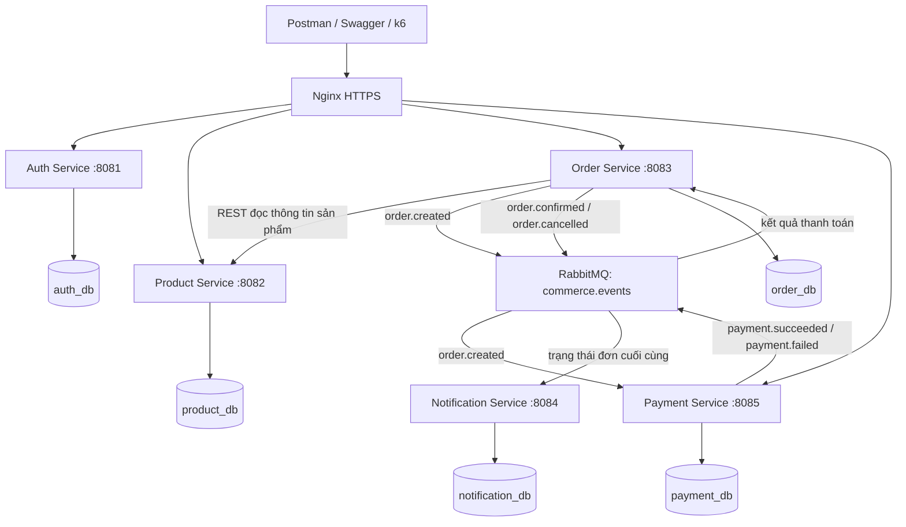
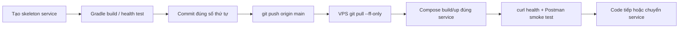
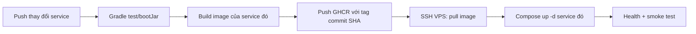

# KẾ HOẠCH PHÁT TRIỂN OMNICHANNEL E-COMMERCE — THEO TỪNG SERVICE, PUSH & DEPLOY NGAY

> **Đề tài:** [Omnichannel E-Commerce (DevOps)](https://github.com/hunghx/Project-MD5---Devops/blob/main/De_Tai_1_Omnichannel_ECommerce.md)  
> **Quy mô:** 1 người, 3 ngày, khoảng 10–12 giờ/ngày  
> **Sản phẩm:** Backend API, không Frontend  
> **Stack:** Java 21, Spring Boot 3.5.6, **Gradle Groovy DSL (`build.gradle`)**, Spring Data JPA, PostgreSQL, Spring Security/JWT, RabbitMQ, Docker Compose, Nginx, Ubuntu VPS, GitHub Actions, Postman, k6  
> **Không sử dụng:** Maven, `pom.xml`, Gradle Kotlin DSL (`build.gradle.kts`), Flyway, Liquibase, thư mục/module `shared`, file `bootstrap.yml`/`bootstrap.properties`, Bootstrap UI, module khởi tạo dữ liệu kiểu `BootstrapData`  
> **Thanh toán:** Payment Service với kết quả giả lập SUCCESS/FAILED; không tích hợp ví điện tử/ngân hàng thật.
> **Repository triển khai:** [dth251/md05-rikkei-project](https://github.com/dth251/md05-rikkei-project) — nhánh `main` (Public).
> **Domain demo:** `md05-rikkei-project.duckdns.org` → IP VPS dự kiến `42.96.2.60`.

---

## 0A. THÔNG TIN TRIỂN KHAI THỰC TẾ (ĐÃ ĐƯỢC CUNG CẤP)

> **Bảo mật:** Tên tài khoản/địa chỉ máy chủ có thể xuất hiện trong bản kế hoạch, nhưng **không lưu mật khẩu gốc** vào tài liệu, source, commit, issue, README, ảnh chụp terminal hoặc workflow. Mật khẩu PostgreSQL và VPS đã được chia sẻ qua hội thoại: **hãy đổi cả hai trước khi chạy ứng dụng online**. Không sử dụng lại mật khẩu cũ trong các ví dụ bên dưới.

| Hạng mục | Cấu hình cần dùng | Ghi chú |
|---|---|---|
| PostgreSQL bootstrap/admin | `postgres` | Tài khoản quản trị khởi tạo PostgreSQL; nên dùng user ứng dụng riêng khi có thời gian |
| PostgreSQL password | `POSTGRES_PASSWORD` (biến môi trường) | **Không ghi giá trị thật vào Git**; thay mật khẩu mới |
| Tên VPS | `azvps-1789407659` | Nhãn nhận diện VPS |
| IP VPS | `42.96.2.60` | Dùng SSH, DNS A record và GitHub Actions variable `VPS_HOST` |
| SSH username ban đầu | `root` | Chỉ sử dụng để thiết lập ban đầu; nên tạo user `deploy` và SSH key |
| SSH password | *Chỉ nhập tương tác khi cần; không ghi vào file kế hoạch* | Thay mật khẩu đã chia sẻ; ưu tiên SSH key |
| GitHub repository | `https://github.com/dth251/md05-rikkei-project.git` | Repository public, default branch `main` (đã kiểm tra) |
| Tên miền | `md05-rikkei-project.duckdns.org` | A record phải trỏ đúng `42.96.2.60` |
| Môi trường production | `/opt/omnichannel-ecommerce` | Đường dẫn code và Compose trên VPS |
| Public HTTPS | `https://md05-rikkei-project.duckdns.org` | Chỉ hoạt động sau khi cấu hình DNS, Nginx và chứng chỉ TLS |

### 0A.1. Clone repository và commit từ máy phát triển

```bash
git clone https://github.com/dth251/md05-rikkei-project.git
cd md05-rikkei-project
git branch --show-current
git status
```

Commit vẫn tuân theo format `NN-ten-service: noi dung thay doi`. Ví dụ sau khi hoàn thành một thay đổi ở Auth:

```bash
git add auth-service
git commit -m "01-auth-service: initialize gradle application and health endpoint"
git push origin main
```

### 0A.2. Đăng nhập VPS, clone code và chuẩn bị bí mật

SSH từ máy cá nhân (mật khẩu được nhập tại prompt SSH nếu chưa cài khóa):

```bash
ssh root@42.96.2.60
```

Trên VPS, sau khi đăng nhập thành công:

```bash
apt update
apt install -y git
mkdir -p /opt
cd /opt
git clone https://github.com/dth251/md05-rikkei-project.git omnichannel-ecommerce
cd /opt/omnichannel-ecommerce
git branch --show-current
```

Vì repository là **public**, thao tác clone/pull source không cần nhúng GitHub token vào URL. Nếu thư mục đã được clone, **không clone đè**; chuyển vào thư mục và `git pull --ff-only origin main`.

**Lưu secret bằng file `.env` riêng trên VPS, không commit**:

```bash
cd /opt/omnichannel-ecommerce
umask 077
nano .env
chmod 600 .env
```

Nội dung MẪU của `.env.example` trong GitHub (chỉ chứa placeholder, KHÔNG điền mật khẩu thật):

```dotenv
POSTGRES_USER=postgres
POSTGRES_PASSWORD=CHANGE_TO_A_NEW_PRIVATE_PASSWORD
AUTH_DB=auth_db
PRODUCT_DB=product_db
ORDER_DB=order_db
PAYMENT_DB=payment_db
NOTIFICATION_DB=notification_db
RABBITMQ_DEFAULT_USER=commerce_app
RABBITMQ_DEFAULT_PASS=CHANGE_TO_A_PRIVATE_RABBITMQ_PASSWORD
JWT_SECRET=CHANGE_TO_A_LONG_RANDOM_JWT_SECRET
DOMAIN=md05-rikkei-project.duckdns.org
```

Các biến trên chỉ có hiệu lực nếu `docker-compose.yml` và `application.yml` **tham chiếu đúng tên biến**. Không sử dụng `POSTGRES_PASSWORD` công khai làm password default trong `application.yml`. Khi truy cập DB giữa các container, dùng hostname `postgres`, không dùng IP public VPS.

Để tránh bỏ sót file bí mật, `.gitignore` tối thiểu phải chứa:

```gitignore
.env
.env.*
!.env.example
**/build/
**/.gradle/
```

### 0A.3. Kéo code mới lên VPS và deploy riêng service

Sau mỗi lần push code từ máy cá nhân, chạy trên VPS (ví dụ `payment-service`):

```bash
cd /opt/omnichannel-ecommerce
git pull --ff-only origin main
docker compose up -d postgres rabbitmq
docker compose up -d --build --no-deps payment-service
docker compose ps payment-service
docker compose logs --tail=60 payment-service
curl --fail http://127.0.0.1:8085/actuator/health
```

Đổi `payment-service` và port theo service đang làm. **Không khai báo port 5432/5672/15672 ra Internet**, không đưa mật khẩu vào lệnh Git. Sau khi cấu hình domain + HTTPS xong, truy cập API qua Nginx thay cho port nội bộ.

### 0A.4. DNS, Nginx và HTTPS theo domain thực tế

1. Đảm bảo DuckDNS cập nhật A record `md05-rikkei-project.duckdns.org` về `42.96.2.60` (nếu IP là cố định).
2. Kiểm tra DNS trên máy cá nhân hoặc VPS:

```bash
getent ahostsv4 md05-rikkei-project.duckdns.org
```

3. Trong Nginx server block, thay `server_name` chung bằng tên miền thực tế:

```nginx
server_name md05-rikkei-project.duckdns.org;
```

4. Sau khi Nginx có server block HTTP hợp lệ, DNS trỏ đúng IP và cổng 80/443 thông suốt, dùng Certbot:

```bash
nginx -t
systemctl reload nginx
certbot --nginx -d md05-rikkei-project.duckdns.org
```

5. Kiểm thử sau khi cấp chứng chỉ thành công:

```bash
curl -I https://md05-rikkei-project.duckdns.org
curl --fail https://md05-rikkei-project.duckdns.org/api/products
```

Request `/api/products` có thể cần dữ liệu hoặc token tùy `SecurityConfig`; hãy xác nhận HTTP status thực tế theo API Contract, không mặc định `curl --fail` luôn thành công.

### 0A.5. GitHub Actions configuration

Trong **Settings → Secrets and variables → Actions**, đặt:

| Loại | Tên | Giá trị / cách cấp |
|---|---|---|
| Variable | `VPS_HOST` | `42.96.2.60` |
| Variable | `VPS_USER` | `deploy` (sau khi tạo và kiểm thử tài khoản SSH key); nếu chưa có chỉ dùng `root` tạm thời |
| Variable | `DEPLOY_PATH` | `/opt/omnichannel-ecommerce` |
| Variable | `DOMAIN` | `md05-rikkei-project.duckdns.org` |
| Secret | `VPS_SSH_KEY` | Private SSH deploy key tạo riêng cho workflow (không dùng VPS password) |
| Secret | `GHCR_TOKEN` | Chỉ khi thực sự cần token bổ sung để kéo private image; ưu tiên `GITHUB_TOKEN` có `packages: write` |

**Không tạo GitHub Actions secret chứa mật khẩu root SSH** để dễ deploy. Tạo một tài khoản triển khai giới hạn quyền, SSH key và cấu hình quyền Docker cần thiết. Sau khi đăng nhập bằng key thành công, mới cân nhắc vô hiệu hóa mật khẩu SSH và đăng nhập root từ xa để tránh tự khóa server.

---

## 0. Các quy ước BẮT BUỘC

1. **Phát triển theo từng service độc lập, không code cả 5 service cùng lúc.** Thứ tự: **hạ tầng → Auth → Product → Order/Inventory → Payment → Notification → CI/CD & test hoàn chỉnh**.
2. **Mỗi khi một service đạt mốc chạy được:** build local → test health/smoke → commit → `git push` → VPS `git pull` → build/deploy **chỉ service đó** → test qua VPS. Sau đó mới chuyển service tiếp theo.
3. **Được phép push sớm bản skeleton** (chỉ Spring Boot main + health endpoint), deploy thử, rồi hoàn thiện nghiệp vụ ở commit tiếp theo. Nhưng **không đánh dấu hoàn thành** khi chỉ có skeleton hoặc khi service chưa được kiểm thử.
4. **Commit message theo thứ tự tăng dần:** `NN-ten-service: noi dung thay doi`. Ví dụ: `03-auth-service: implement registration and jwt login`. Không đổi số thứ tự, không gộp nhiều service vào một commit nếu có thể tách được.
5. **Mỗi service tự sở hữu** controller, service, entity, repository, DTO, security cần thiết và exception handler. Không tạo module Java dùng chung, không tạo thư mục `shared` như ảnh đã gửi. Phần giống nhau có thể viết lặp tối thiểu, nhưng cần giữ đồng nhất JWT contract và format lỗi.
6. **Code phải dễ đọc:** mỗi tham số/mỗi thuộc tính/annotation quan trọng/mỗi lệnh ở dòng riêng; xuống dòng khi khai báo `record`, constructor, method, SQL và Gradle dependencies. **Không** gộp cả record/DTO hoặc nhiều command Shell lên một dòng.
7. **Không sử dụng Flyway:** dùng Hibernate `ddl-auto: update` cho MVP demo, PostgreSQL init script chỉ tạo database/user ban đầu. Giữ volume dữ liệu, không dùng `create-drop`.
8. **Không có Frontend:** demo toàn bộ bằng Postman, Swagger (nếu kịp), curl, RabbitMQ logs và k6. Không có yêu cầu Bootstrap CSS/JS.
9. **Không có `bootstrap.yml`:** mỗi ứng dụng dùng `application.yml`. `@SpringBootApplication` và lớp `*Application.java` là điểm khởi chạy bắt buộc của Spring Boot, **không phải** thư mục/module Bootstrap cần loại bỏ.
10. **Không đăng secret lên GitHub:** `.env` thật chỉ lưu local/VPS; commit `.env.example`; JWT secret, database password và RabbitMQ password lấy từ biến môi trường.

**Lưu ý phạm vi:** Đây là một MVP demo triển khai theo service cho 1 người trong 3 ngày. Chưa có distributed transaction bảo đảm tuyệt đối nếu chưa làm Outbox, Saga đầy đủ và xử lý lỗi liên dịch vụ. Những thiếu sót cần nêu rõ trong báo cáo.

---

## 1. Kiến trúc và trách nhiệm service

### 1.1. Sơ đồ tổng quan



### 1.2. Phạm vi từng service

| Thứ tự code | Service | Port | Database | Chức năng thiết yếu |
|---|---|---:|---|---|
| 1 | `auth-service` | 8081 | `auth_db` | Register, login, JWT, USER/ADMIN |
| 2 | `product-service` | 8082 | `product_db` | CRUD SKU, tên, giá, trạng thái bán |
| 3 | `order-service` | 8083 | `order_db` | WEB/POS order, order items, kho, idempotency, xử lý kết quả thanh toán |
| 4 | `payment-service` | 8085 | `payment_db` | Consumer `order.created`, Payment PENDING, mô phỏng SUCCESS/FAILED |
| 5 | `notification-service` | 8084 | `notification_db` | Consumer trạng thái cuối, lưu log thông báo |

**Một PostgreSQL instance, 5 database và 5 user độc lập.** Không dùng foreign key xuyên database và không cho service truy cập trực tiếp database của nhau. Order Service là chủ sở hữu inventory; Product Service chỉ lưu thông tin hàng hóa/giá.

### 1.3. RabbitMQ topology được tạo TRƯỚC các nghiệp vụ

Do deploy dần từng service, phải bảo đảm event không bị mất vì consumer chưa chạy:

| Thành phần | Giá trị | Ý nghĩa |
|---|---|---|
| Topic exchange | `commerce.events` | Phát event |
| Queue | `payment.order-created.q` | Bind `order.created` |
| Queue | `order.payment-result.q` | Bind `payment.succeeded` và `payment.failed` |
| Queue | `notification.order.q` | Bind `order.confirmed` và `order.cancelled` |

- Tạo exchange/queues/bindings **durable trước** lúc Order bắt đầu phát sự kiện; có thể provision bằng file RabbitMQ definitions hoặc một bước cấu hình hạ tầng riêng. Không trông chờ Payment/Notification tự khai báo queue khi chúng chưa deploy.
- Publisher gửi message persistent. Consumer chỉ ACK sau khi ghi DB thành công; bổ sung unique `event_id` / processed-events để chống xử lý lặp.
- Nếu Payment chưa triển khai, `order.created` nằm chờ ở queue, Order ở trạng thái `PENDING_PAYMENT`. Không giả định đơn tự hoàn tất.
- Với bản MVP chưa Outbox, vẫn còn rủi ro crash ngay sau DB commit nhưng trước lúc publish event. Ghi rõ giới hạn; làm Outbox nếu còn thời gian.

---

## 2. Monorepo: Gradle Groovy, KHÔNG có `shared` và `bootstrap`

```text
omnichannel-ecommerce/
│
├── auth-service/
│   ├── src/main/java/com/app/auth/
│   │   ├── AuthApplication.java
│   │   ├── controller/
│   │   ├── dto/
│   │   ├── entity/
│   │   ├── repository/
│   │   ├── service/
│   │   ├── security/
│   │   │   ├── JwtConfiguration.java
│   │   │   ├── JwtSettings.java
│   │   │   └── StatelessSecurity.java
│   │   └── web/
│   │       ├── ApiErrors.java
│   │       └── ApiException.java
│   ├── src/main/resources/application.yml
│   ├── src/test/java/com/app/auth/
│   ├── gradle/wrapper/
│   ├── gradlew
│   ├── gradlew.bat
│   ├── build.gradle
│   ├── settings.gradle
│   └── Dockerfile
│
├── product-service/
│   ├── src/main/java/com/app/product/
│   │   ├── ProductApplication.java
│   │   ├── controller/
│   │   ├── dto/
│   │   ├── entity/
│   │   ├── repository/
│   │   ├── service/
│   │   ├── security/
│   │   └── web/
│   ├── src/main/resources/application.yml
│   ├── gradle/wrapper/
│   ├── gradlew
│   ├── build.gradle
│   ├── settings.gradle
│   └── Dockerfile
│
├── order-service/
│   ├── src/main/java/com/app/order/
│   │   ├── OrderApplication.java
│   │   ├── controller/
│   │   ├── dto/
│   │   ├── entity/
│   │   ├── repository/
│   │   ├── service/
│   │   ├── client/
│   │   ├── messaging/
│   │   ├── security/
│   │   └── web/
│   ├── src/main/resources/application.yml
│   ├── gradle/wrapper/
│   ├── gradlew
│   ├── build.gradle
│   ├── settings.gradle
│   └── Dockerfile
│
├── payment-service/
│   ├── src/main/java/com/app/payment/
│   │   ├── PaymentApplication.java
│   │   ├── controller/
│   │   ├── dto/
│   │   ├── entity/
│   │   ├── repository/
│   │   ├── service/
│   │   ├── messaging/
│   │   ├── security/
│   │   └── web/
│   ├── src/main/resources/application.yml
│   ├── gradle/wrapper/
│   ├── gradlew
│   ├── build.gradle
│   ├── settings.gradle
│   └── Dockerfile
│
├── notification-service/
│   ├── src/main/java/com/app/notification/
│   │   ├── NotificationApplication.java
│   │   ├── entity/
│   │   ├── repository/
│   │   ├── service/
│   │   ├── messaging/
│   │   └── config/
│   ├── src/main/resources/application.yml
│   ├── gradle/wrapper/
│   ├── gradlew
│   ├── build.gradle
│   ├── settings.gradle
│   └── Dockerfile
│
├── infrastructure/
│   ├── postgres/
│   │   └── init-databases.sh
│   ├── rabbitmq/
│   │   └── definitions.json
│   └── nginx/
│       └── ecommerce.conf
│
├── tests/
│   ├── postman/
│   └── k6/
│       ├── race-condition.js
│       └── load-test.js
│
├── docs/
│   ├── architecture.md
│   ├── api-contract.md
│   ├── commits-and-deployments.md
│   └── test-results.md
│
├── .github/workflows/
│   ├── ci.yml
│   └── deploy.yml
├── docker-compose.yml
├── docker-compose.production.yml
├── .env.example
├── .gitignore
└── README.md
```

**Quyết định về mã dùng chung:** không tạo thư mục `shared` hoặc thư viện JAR chứa security/exception/DTO. JWT claim format và error shape là **API contract trong `docs/`**. Mỗi service tự có security filter và handler nếu cần; Notification không phục vụ API nghiệp vụ public nên không cần ép copy lớp JWT vào Notification.

**Gradle wrapper:** mỗi service có `gradlew`, `gradle/wrapper`, `build.gradle`, `settings.gradle` riêng; build và deploy độc lập. `gradle/wrapper/gradle-wrapper.jar` là binary cần commit cho wrapper, không phải thư viện `shared`.

---

## 3. Quy tắc viết code: xuống dòng rõ ràng

### 3.1. Java record theo đúng kiểu bạn yêu cầu

**NÊN dùng:**

```java
package com.app.auth.dto;

import jakarta.validation.constraints.Email;
import jakarta.validation.constraints.NotBlank;
import jakarta.validation.constraints.Size;

public record RegisterRequest(
        @NotBlank
        @Size(max = 100)
        String fullName,

        @NotBlank
        @Email
        @Size(max = 150)
        String email,

        @NotBlank
        @Size(min = 8, max = 72)
        String password
) {
}
```

**KHÔNG dùng:**

```java
public record RegisterRequest(@NotBlank String fullName, @NotBlank String email, @NotBlank String password) {}
```

### 3.2. Method và constructor

```java
public OrderResponse createOrder(
        Long userId,
        CreateOrderRequest request
) {
    validateRequest(request);

    Order order = reserveInventoryAndSaveOrder(
            userId,
            request
    );

    publishOrderCreated(order);

    return toResponse(order);
}
```

> **Đây là ví dụ quy ước định dạng, không phải implementation hoàn chỉnh.** Trong implementation thực, publish RabbitMQ sau database commit hoặc dùng Outbox; không publish trực tiếp trong một transaction chưa commit.

### 3.3. Gradle Groovy DSL: `build.gradle` mẫu cho Auth Service

Ví dụ sử dụng Spring Boot `3.5.6`, Java 21, Gradle Groovy. Thay đổi dependencies riêng cho từng service, không copy hết thư viện vào mọi service.

```groovy
plugins {
    id 'java'
    id 'org.springframework.boot' version '3.5.6'
    id 'io.spring.dependency-management' version '1.1.7'
}

group = 'com.app'
version = '0.0.1-SNAPSHOT'

java {
    toolchain {
        languageVersion = JavaLanguageVersion.of(21)
    }
}

repositories {
    mavenCentral()
}

dependencies {
    implementation 'org.springframework.boot:spring-boot-starter-web'
    implementation 'org.springframework.boot:spring-boot-starter-security'
    implementation 'org.springframework.boot:spring-boot-starter-data-jpa'
    implementation 'org.springframework.boot:spring-boot-starter-validation'
    implementation 'org.springframework.boot:spring-boot-starter-actuator'

    implementation 'io.jsonwebtoken:jjwt-api:0.12.6'
    runtimeOnly 'io.jsonwebtoken:jjwt-impl:0.12.6'
    runtimeOnly 'io.jsonwebtoken:jjwt-jackson:0.12.6'
    runtimeOnly 'org.postgresql:postgresql'

    testImplementation 'org.springframework.boot:spring-boot-starter-test'
    testRuntimeOnly 'org.junit.platform:junit-platform-launcher'
}

tasks.named('test') {
    useJUnitPlatform()
}

tasks.named('bootJar') {
    archiveFileName = 'app.jar'
}

tasks.named('jar') {
    enabled = false
}
```

`auth-service/settings.gradle`:

```groovy
rootProject.name = 'auth-service'
```

**Dependencies theo service** (ngoài `starter-web`, `data-jpa`, `postgresql`, `actuator` nếu service dùng REST/DB):

| Service | Bổ sung chủ yếu |
|---|---|
| Auth | `security`, `validation`, JJWT |
| Product | `security`, `validation`, JJWT để verify JWT |
| Order | `security`, `validation`, JJWT, `spring-boot-starter-amqp` |
| Payment | `security`, `validation`, JJWT, `spring-boot-starter-amqp` |
| Notification | `spring-boot-starter-amqp`, không cần Security JWT nếu chỉ expose health nội bộ |

Không dùng `implementation project(':shared')` vì không có module `shared`. Đối với Product/Order/Payment, nếu không muốn duplicate logic parse JWT, vẫn viết lớp security tối giản tại từng service; **không tách thư viện dùng chung** trong 3 ngày này.

### 3.4. Cấu hình mỗi service dùng `application.yml`

Ví dụ Order Service:

```yaml
server:
  port: 8083

spring:
  datasource:
    url: ${DB_URL:jdbc:postgresql://localhost:5432/order_db}
    username: ${DB_USERNAME:order_user}
    password: ${DB_PASSWORD}

  jpa:
    hibernate:
      ddl-auto: update
    open-in-view: false

  rabbitmq:
    host: ${RABBITMQ_HOST:localhost}
    port: ${RABBITMQ_PORT:5672}
    username: ${RABBITMQ_USERNAME}
    password: ${RABBITMQ_PASSWORD}

management:
  endpoints:
    web:
      exposure:
        include: health,info
```

- Không có `bootstrap.yml` hoặc `bootstrap.properties`.
- `ddl-auto: update` chỉ phục vụ phát triển/demo; thay đổi schema phức tạp cần kiểm tra và sao lưu trước khi deploy. Không dùng Hibernate tạo bảng thay cho quá trình migration production chính quy.
- Local dùng `localhost`; container dùng `postgres`, `rabbitmq` qua biến môi trường.

### 3.5. Dockerfile mẫu trong MỖI service

```dockerfile
FROM eclipse-temurin:21-jdk AS build
WORKDIR /workspace

COPY gradlew ./
COPY gradle ./gradle
COPY settings.gradle ./
COPY build.gradle ./
COPY src ./src

RUN chmod +x ./gradlew
RUN ./gradlew bootJar --no-daemon

FROM eclipse-temurin:21-jre
WORKDIR /app

COPY --from=build /workspace/build/libs/app.jar /app/app.jar

EXPOSE 8081

ENTRYPOINT ["java", "-jar", "/app/app.jar"]
```

Với Product/Order/Payment/Notification, đổi `EXPOSE` hoặc dùng `server.port` theo service. Thêm `.dockerignore` để bỏ `.gradle/`, `build/` và `.git/` khỏi Docker build context; giữ `gradle/wrapper/` trong image build.

---

## 4. Chuẩn bị hạ tầng trước khi viết business code (Ngày 1)

### 4.1. Local

- Java 21, Git, Docker Engine + Compose plugin, Postman và k6 (k6 có thể cài ngày 3).
- Sử dụng repository đã xác nhận: `https://github.com/dth251/md05-rikkei-project.git` (public, branch `main`). Không push vào repository đề bài của người khác.
- Tạo 5 thư mục service Gradle độc lập, 1 `.env.example` và `.gitignore`.
- Docker Compose có `postgres` và `rabbitmq`; volume riêng cho PostgreSQL/RabbitMQ.
- PostgreSQL init script tạo 5 database (`auth_db`, `product_db`, `order_db`, `payment_db`, `notification_db`), chỉ thực thi ở lần khởi tạo volume đầu tiên. Tài khoản admin/bootstrap hiện dùng `postgres`; môi trường production nên tạo user ứng dụng riêng, không cấp quyền superuser cho cả 5 service.
- Provision RabbitMQ exchange/queues/bindings trước khi thử gửi event.

### 4.2. VPS

Làm ngay từ đầu thay vì chờ ngày 3:

- Sử dụng VPS `azvps-1789407659` (`42.96.2.60`), SSH ban đầu `root@42.96.2.60`, domain `md05-rikkei-project.duckdns.org`; không đưa password SSH/DB vào tài liệu hoặc code.
- Cài Git, Docker, Docker Compose plugin, Nginx và Certbot.
- Khởi tạo `/opt/omnichannel-ecommerce` bằng `git clone https://github.com/dth251/md05-rikkei-project.git omnichannel-ecommerce` khi ở `/opt`. Repository public, không cần PAT để clone/pull.
- Tạo `/opt/omnichannel-ecommerce/.env` trên VPS, chỉ cho user vận hành đọc. **Không commit file này**.
- Ban đầu chỉ chạy PostgreSQL/RabbitMQ. Khi build xong service nào thì `git pull` và `docker compose up` service đó.
- Chỉ Nginx có HTTP/HTTPS public. Các application port nếu cần dùng từ host phải bind `127.0.0.1`; PostgreSQL 5432, RabbitMQ 5672/15672 không được expose công khai.

**Về Nginx:** có thể test `curl http://127.0.0.1:8081/actuator/health` ngay sau deploy đầu tiên; khi domain/HTTPS hoạt động thì test thêm qua Nginx. Điều này cho phép deploy sớm từng service mà không phải chờ toàn bộ routing.

---

## 5. Quy trình Push → Pull → Deploy riêng cho TỪNG SERVICE

### 5.1. Vòng lặp chuẩn cho mỗi service



**Trên máy LOCAL** — ví dụ dành cho Auth:

```bash
cd /path/to/omnichannel-ecommerce

cd auth-service
./gradlew clean test bootJar
cd ..

git status
git add auth-service
git commit -m "01-auth-service: initialize gradle application and health endpoint"
git push origin main
```

**Trên VPS** — chỉ thực hiện sau khi đã chuẩn bị repository, secrets và chạy DB/RabbitMQ:

```bash
cd /opt/omnichannel-ecommerce
git pull --ff-only origin main

docker compose up -d postgres rabbitmq
docker compose up -d --build --no-deps auth-service
docker compose ps auth-service
docker compose logs --tail=60 auth-service
curl --fail http://127.0.0.1:8081/actuator/health
```

- `--no-deps` **chỉ dùng khi PostgreSQL/RabbitMQ đã chạy** và kết nối đúng.
- Khi sửa lại Auth, lặp lại `git add`, `git commit`, `git push`, `git pull`, `docker compose up -d --build --no-deps auth-service`, test.
- Đối với Product/Order/Payment/Notification, thay tên service và port health tương ứng.
- Nếu build fail, chỉ sửa và redeploy service đang làm; **không buộc build lại cả 5 service**.
- **Không nên deploy một bản chưa build được lên môi trường demo.** Được push skeleton sớm; việc deploy bản mới nên đạt tối thiểu build + health check, nghiệp vụ chưa làm được ghi `IN PROGRESS`.

### 5.2. Hai chế độ deploy

| Giai đoạn | Cách làm | Lý do |
|---|---|---|
| 2 ngày đầu | **Manual incremental:** local push → VPS pull → `docker compose up -d --build --no-deps <service>` | Nhanh, dễ debug, đúng yêu cầu deploy từng service |
| Cuối ngày 2/ngày 3 | **CI/CD:** GitHub Actions Gradle test → build image → push GHCR → VPS pull image → recreate đúng service | Hạn chế build trên VPS, có lịch sử workflow và logs |

Nếu VPS nhỏ, tránh 5 Gradle builds đồng thời trên VPS. Khi chuyển sang CI/CD, image nên mang tag commit SHA (`sha-...`) để biết chính xác phiên bản được deploy; không phụ thuộc duy nhất vào `latest`.

---

## 6. KẾ HOẠCH THỰC THI THEO SERVICE — các mốc phải push/deploy

## SERVICE 0 — Infrastructure (khởi tạo đầu Ngày 1)

**Thời gian:** Ngày 1, 08:00–10:00 (2 giờ).  
**Đầu ra:** PostgreSQL, RabbitMQ, repository và VPS sẵn sàng tiếp nhận service.

**Các bước:**

1. Tạo monorepo, `.gitignore`, `.env.example`, `docker-compose.yml`.
2. Tạo PostgreSQL users/databases, volume.
3. Tạo RabbitMQ `commerce.events` và 3 queue/bindings durable.
4. Cài Docker/Git trên VPS, clone repository, cấu hình `.env` trên máy chủ.
5. Local test `docker compose ps` rồi push; VPS pull và up `postgres`, `rabbitmq`.

**Commit:**

```bash
git add docker-compose.yml
git add .env.example
git add .gitignore
git add infrastructure
git commit -m "00-infrastructure: initialize postgres rabbitmq and deployment layout"
git push origin main
```

**VPS:**

```bash
cd /opt/omnichannel-ecommerce
git pull --ff-only origin main
docker compose up -d postgres rabbitmq
docker compose ps
```

**Done:** Database/queue tồn tại và có volume; không lộ port DB, RabbitMQ ra public.

### SERVICE 1 — Auth Service (Ngày 1)

**Thời gian:** 10:00–14:00 (4 giờ, có nghỉ giữa buổi).  
**Làm một mình service Auth, không code Product đồng thời.**

**Việc cần làm:**

1. Tạo `auth-service/build.gradle`, `settings.gradle`, Gradle wrapper, `AuthApplication.java`, Actuator health, Dockerfile.
2. **Push sớm** skeleton lên GitHub, VPS pull/deploy và gọi health endpoint.
3. Tạo `User` Entity, Repository, `RegisterRequest`, `LoginRequest`, `AuthResponse`.
4. Tạo `JwtSettings`, `JwtConfiguration`, `StatelessSecurity` **trong package `com.app.auth.security`** (không phải `com.app.shared.security`).
5. Tạo `ApiErrors`, `ApiException` **trong package `com.app.auth.web`**.
6. Register + BCrypt; login cấp JWT; `GET /api/auth/me`.
7. Test register/login, JWT hết hạn và RBAC USER/ADMIN; commit/push/deploy lần nữa.

**API:**

| Method | Endpoint | Quyền |
|---|---|---|
| POST | `/api/auth/register` | Public |
| POST | `/api/auth/login` | Public |
| GET | `/api/auth/me` | JWT |

**Commit/deploy:**

```bash
git add auth-service
git commit -m "01-auth-service: initialize gradle application and health endpoint"
git push origin main
```

Sau khi test nghiệp vụ:

```bash
git add auth-service
git commit -m "02-auth-service: implement registration login jwt and security"
git push origin main
```

VPS (mỗi lần sau khi push):

```bash
cd /opt/omnichannel-ecommerce
git pull --ff-only origin main
docker compose up -d --build --no-deps auth-service
curl --fail http://127.0.0.1:8081/actuator/health
```

**Done:** Health 200, register trả 201, login có JWT, thiếu token trả 401, role không hợp lệ trả 403, server dùng lại DB sau restart.

### SERVICE 2 — Product Service (Ngày 1)

**Thời gian:** 14:00–18:00 (4 giờ).  
**Tiền đề:** Auth đã cấp JWT, hạ tầng đang chạy.

**Việc cần làm:**

1. Tạo skeleton Gradle/Dockerfile/health; push ngay, pull/deploy service Product.
2. Entity `Product(id, sku, name, description, price, active, createdAt)`.
3. `ProductRepository`, `ProductService`, `ProductController`, Request/Response records.
4. Security local của Product kiểm tra JWT signature và role; không gọi DB Auth trực tiếp.
5. Validate SKU unique, `price > 0`, soft delete `active=false`.
6. Test Product CRUD, USER không được POST/PUT/DELETE, ADMIN được thực hiện.
7. Commit/push và deploy lại đúng Product Service; smoke test qua VPS.

**API:**

| Method | Endpoint | Quyền |
|---|---|---|
| GET | `/api/products` | Public |
| GET | `/api/products/{id}` | Public |
| POST | `/api/products` | ADMIN |
| PUT | `/api/products/{id}` | ADMIN |
| DELETE | `/api/products/{id}` | ADMIN |

**Commits:**

```bash
git add product-service
git commit -m "03-product-service: initialize gradle application and health endpoint"
git push origin main
```

```bash
git add product-service
git commit -m "04-product-service: implement product crud validation and jwt authorization"
git push origin main
```

**VPS:**

```bash
cd /opt/omnichannel-ecommerce
git pull --ff-only origin main
docker compose up -d --build --no-deps product-service
curl --fail http://127.0.0.1:8082/actuator/health
```

**Done:** Product database có dữ liệu, API GET/POST/PUT/DELETE test được, JWT RBAC hợp lệ.

### SERVICE 3 — Order & Inventory Service (Ngày 1 cuối + Ngày 2 sáng)

**Thời gian:** Ngày 1, 19:00–21:00 tạo skeleton; Ngày 2, 08:00–12:30 phát triển nghiệp vụ (6,5 giờ).  
**Đây là phần cần dành nhiều thời gian nhất.**

**Việc cần làm theo đúng trình tự:**

1. Tạo Order Gradle/Dockerfile/health; push và deploy skeleton ngay cuối Ngày 1.
2. Entity: `Order`, `OrderItem`, `Inventory`, `ProcessedEvent` (khuyến nghị).
3. Order dùng REST client gọi Product Service lấy snapshot giá/tên; không đọc `product_db`.
4. Dữ liệu `Order`: `userId`, `channel` (`WEB`/`POS`), `status`, `totalAmount`, `idempotencyKey`.
5. `POST /api/orders` xác thực JWT, kiểm tra mặt hàng, gọi atomic SQL giữ kho, lưu order/items trong `@Transactional`.
6. Lưu `idempotencyKey` unique theo người dùng để chống retry trừ kho lần hai.
7. Khi commit thành công publish `order.created` tới RabbitMQ (hoặc Outbox nếu đủ thời gian).
8. Đảm bảo Payment chưa có thì order giữ `PENDING_PAYMENT`, event vẫn nằm trong queue.
9. Viết consumer của `payment.succeeded` / `payment.failed` từ đầu ở dạng skeleton; hoàn thiện xử lý ở bước sau khi Payment đã chạy.
10. Test 100 request tranh 1 sản phẩm; 1 success/99 conflict (kỳ vọng), không bán vượt kho.

**Database:**

| Bảng | Cột quan trọng |
|---|---|
| `orders` | id, user_id, channel, status, total_amount, idempotency_key |
| `order_items` | id, order_id, product_id, product_name, unit_price, quantity |
| `inventory` | product_id UNIQUE, available, reserved |
| `processed_events` | event_id UNIQUE, event_type, processed_at |

**API:**

| Method | Endpoint | Chức năng |
|---|---|---|
| POST | `/api/orders` | Giữ kho và tạo đơn PENDING_PAYMENT |
| GET | `/api/orders/{id}` | Đọc order của user |
| GET | `/api/orders` | Liệt kê order đúng quyền |
| GET | `/api/inventory/{productId}` | Kiểm tra tồn kho |
| POST | `/api/inventory/stocks` | ADMIN thêm tồn kho |

**SQL atomic, xuống dòng theo câu lệnh:**

```sql
UPDATE inventory
SET
    available = available - :quantity,
    reserved = reserved + :quantity
WHERE
    product_id = :productId
    AND available >= :quantity;
```

**Repository ví dụ:**

```java
@Modifying
@Query(
        value = """
                UPDATE inventory
                SET
                    available = available - :quantity,
                    reserved = reserved + :quantity
                WHERE
                    product_id = :productId
                    AND available >= :quantity
                """,
        nativeQuery = true
)
int reserveStock(
        @Param("productId") Long productId,
        @Param("quantity") int quantity
);
```

Lưu ý: method này phải được gọi trong transaction. Kiểm tra kết quả cập nhật bằng 1 trước khi lưu đơn. Nếu nhiều item, giữ kho theo thứ tự `productId` để giảm deadlock, rollback toàn bộ nếu một item hết hàng.

**Commits:**

```bash
git add order-service
git commit -m "05-order-service: initialize gradle entities and health endpoint"
git push origin main
```

```bash
git add order-service
git commit -m "06-order-service: implement order api and atomic inventory reservation"
git push origin main
```

```bash
git add order-service
git commit -m "07-order-service: publish order created events to rabbitmq"
git push origin main
```

**VPS sau mỗi commit ổn định:**

```bash
cd /opt/omnichannel-ecommerce
git pull --ff-only origin main
docker compose up -d --build --no-deps order-service
curl --fail http://127.0.0.1:8083/actuator/health
```

**Done:** Tạo WEB/POS orders, Order DB lưu đúng; race test không oversell; `order.created` vào đúng payment queue.

### SERVICE 4 — Payment Service (Ngày 2 chiều)

**Thời gian:** Ngày 2, 13:00–17:00 (4 giờ).  
**Không tích hợp thanh toán thật.**

**Việc cần làm:**

1. Tạo Payment Gradle/Dockerfile/health; push skeleton và pull/deploy ngay.
2. Entity `Payment(id, orderId, userId, amount, method, status, createdAt)`; `orderId` UNIQUE, `method=MOCK`.
3. Consumer `order.created` tạo Payment `PENDING` (idempotent, kiểm tra `eventId`/`orderId`).
4. `GET /api/payments/by-order/{orderId}` để Postman chờ Payment được tạo bất đồng bộ.
5. Admin-only `POST /api/payments/{id}/simulate` nhận `SUCCESS` hoặc `FAILED`.
6. Cập nhật Payment status chỉ nếu đang `PENDING`; không cho đổi SUCCESS → FAILED; tránh publish trùng khi retry.
7. Publish `payment.succeeded` hoặc `payment.failed` đến RabbitMQ.
8. Trong Order Service, hoàn thiện consumer payment result và re-deploy **chỉ Order** (đây là lần quay lại hợp lý sau khi Payment có event).
9. Test 2 luồng: SUCCESS → order CONFIRMED, FAILED → order CANCELLED và hoàn kho.

**Payment DB:** `payments`, `processed_events` (eventId UNIQUE). Không tạo foreign key sang `order_db`.

**API:**

| Method | Endpoint | Quyền |
|---|---|---|
| GET | `/api/payments/{id}` | Chủ đơn/ADMIN |
| GET | `/api/payments/by-order/{orderId}` | Chủ đơn/ADMIN |
| POST | `/api/payments/{id}/simulate` | ADMIN, chỉ để demo |

**Payload test:**

```json
{
  "result": "SUCCESS"
}
```

**Event thanh toán:**

```json
{
  "eventId": "payment-event-001",
  "eventType": "PAYMENT_SUCCEEDED",
  "paymentId": 901,
  "orderId": 1001,
  "amount": 250000.00
}
```

**Commits:**

```bash
git add payment-service
git commit -m "08-payment-service: initialize gradle payments and health endpoint"
git push origin main
```

```bash
git add payment-service
git commit -m "09-payment-service: consume order events and simulate payment outcomes"
git push origin main
```

Order consumer được bổ sung sau khi có event mẫu:

```bash
git add order-service
git commit -m "10-order-service: process payment results and release reserved inventory"
git push origin main
```

**VPS:**

```bash
cd /opt/omnichannel-ecommerce
git pull --ff-only origin main
docker compose up -d --build --no-deps payment-service
curl --fail http://127.0.0.1:8085/actuator/health
```

Sau commit `10-order-service`:

```bash
cd /opt/omnichannel-ecommerce
git pull --ff-only origin main
docker compose up -d --build --no-deps order-service
curl --fail http://127.0.0.1:8083/actuator/health
```

**Done:** Payment PENDING được tạo từ RabbitMQ, API simulate chạy, Order cập nhật đúng thành CONFIRMED/CANCELLED, xử lý duplicate event không chốt/hoàn kho lần hai.

### SERVICE 5 — Notification Service (Ngày 2 tối / Ngày 3 đầu)

**Thời gian:** Ngày 2, 17:00–19:00 và Ngày 3, 08:00–09:00 nếu cần.

**Việc cần làm:**

1. Tạo Notification Gradle, Postgres DB, health + Dockerfile; push nhanh skeleton, pull/deploy.
2. Tạo `Notification` Entity gồm `eventId` UNIQUE, `orderId`, `userId`, `type`, `status`, `createdAt`.
3. Consume `order.confirmed` / `order.cancelled` từ queue durable đã provision.
4. Dùng `@RabbitListener`, ghi DB, ACK sau thành công; event trùng không lưu lại bản ghi.
5. Test dừng Notification (`docker compose stop notification-service`), simulate Payment, kiểm tra Order vẫn xong; chạy lại Notification và message được consume.
6. Không gửi email/SMS thật.

**Commits:**

```bash
git add notification-service
git commit -m "11-notification-service: initialize gradle application and health endpoint"
git push origin main
```

```bash
git add notification-service
git commit -m "12-notification-service: consume order outcome events and persist notifications"
git push origin main
```

**VPS:**

```bash
cd /opt/omnichannel-ecommerce
git pull --ff-only origin main
docker compose up -d --build --no-deps notification-service
curl --fail http://127.0.0.1:8084/actuator/health
```

**Done:** `notification_db` nhận outcome event, không tạo duplicate, recover event sau khi restart.

---

## 7. Phân bổ thời gian tổng thể 3 ngày (theo service đã deploy)

| Ngày | Khung giờ | Service/hạng mục | Bằng chứng cuối mốc |
|---|---|---|---|
| **1** | 08:00–10:00 | Infrastructure: GitHub, Docker, PostgreSQL, RabbitMQ, VPS clone | Commit `00`, VPS có DB/MQ |
| **1** | 10:00–14:00 | Auth: skeleton → business → push/deploy | Commits `01–02`, Auth health/login trên VPS |
| **1** | 14:00–18:00 | Product: skeleton → CRUD → push/deploy | Commits `03–04`, CRUD trên VPS |
| **1** | 19:00–21:00 | Order skeleton/entity → push/deploy | Commit `05`, Order health trên VPS |
| **2** | 08:00–12:30 | Order nghiệp vụ + RabbitMQ → push/deploy | Commits `06–07`, order.created được queue |
| **2** | 13:00–17:00 | Payment + Order payment consumer → push/deploy | Commits `08–10`, Payment SUCCESS/FAILED |
| **2** | 17:00–19:00 | Notification → push/deploy | Commits `11–12`, notification events |
| **2** | 19:00–21:00 | Test end-to-end và sửa P0 | Test manual toàn luồng |
| **3** | 08:00–10:00 | Notification polish, Nginx, TLS, deploy ổn định | HTTPS các public API |
| **3** | 10:00–13:00 | CI/CD Gradle + GHCR + selective deploy | Workflow chạy thành công |
| **3** | 14:00–17:00 | k6, race, failure/recovery, logs | Kết quả thực đo |
| **3** | 19:00–21:00 | README, báo cáo, ảnh/video demo | Tài liệu nộp |

**Các mốc trên rất gấp.** Khi trễ phải giảm Swagger/email/monitoring, không được bỏ Payment hay sửa kho sai để đạt tiến độ.

---

## 8. Nginx, HTTPS và deploy production

### 8.1. Public API routing (Nginx cài trên VPS host)

| Route | Forward tới host loopback |
|---|---|
| `/api/auth/**` | `127.0.0.1:8081` |
| `/api/products/**` | `127.0.0.1:8082` |
| `/api/orders/**` | `127.0.0.1:8083` |
| `/api/inventory/**` | `127.0.0.1:8083` |
| `/api/payments/**` | `127.0.0.1:8085` |

- Notification không expose business API công khai. Health endpoints chỉ để loopback/VPN/admin, không mở public tùy tiện.
- Compose app port mapping dùng `127.0.0.1:8081:8081` (tương ứng từng service). PostgreSQL và RabbitMQ **không** public host port trên VPS.
- Chỉ mở cổng SSH cho IP cần thiết, TCP 80/443; đảm bảo SSH còn dùng được trước khi bật UFW. Khi dùng Docker, một số published ports có thể vượt UFW: tuyệt đối không publish DB/MQ ra `0.0.0.0`.
- DNS `md05-rikkei-project.duckdns.org` phải trỏ về `42.96.2.60`; đặt đúng `server_name`, kiểm tra `nginx -t`, lấy chứng chỉ Let's Encrypt và kiểm thử `https://md05-rikkei-project.duckdns.org`.

### 8.2. GitHub Actions dùng Gradle, không Maven

**Giai đoạn đầu:** push GitHub bằng Git, VPS pull/build bằng Compose như mục 5.1.  
**Giai đoạn ổn định:** CI/CD theo từng service:



- `ci.yml`: trigger push/PR, chạy `./gradlew test bootJar` trong thư mục service thay đổi. Có thể dùng `paths` filter hoặc job riêng per service, **không bắt buộc build đủ 5 service mỗi lần**.
- `deploy.yml`: trigger từ workflow thành công hoặc manual `workflow_dispatch` với input `service`; build/push GHCR rồi SSH VPS chỉ cập nhật service đã chọn.
- **Không dùng** `mvn test`, `mvn package`, `pom.xml`.
- Bắt đầu đơn giản: deploy manual theo service trước; chỉ chuyển sang Actions khi đủ 5 service chạy và test được.
- Khi dùng image từ GHCR, `docker-compose.production.yml` trỏ tới đúng image/tag; VPS **không cần rebuild**. Không trộn lệnh `--build` với deploy image đã build sẵn.
- Variables: `VPS_HOST=42.96.2.60`, `DOMAIN=md05-rikkei-project.duckdns.org`, `DEPLOY_PATH=/opt/omnichannel-ecommerce`; Secrets: `VPS_SSH_KEY` và token registry nếu cần. Không đưa mật khẩu SSH/DB vào logs hoặc repository.

**Ví dụ một job Gradle riêng:**

```yaml
name: Build Auth Service

on:
  push:
    paths:
      - 'auth-service/**'
      - '.github/workflows/auth-ci.yml'
  workflow_dispatch:

jobs:
  auth-test:
    runs-on: ubuntu-latest
    defaults:
      run:
        working-directory: auth-service

    steps:
      - name: Checkout
        uses: actions/checkout@v4

      - name: Set up Java 21
        uses: actions/setup-java@v4
        with:
          distribution: temurin
          java-version: '21'

      - name: Grant execute permission
        run: chmod +x gradlew

      - name: Gradle test and bootJar
        run: ./gradlew clean test bootJar --no-daemon
```

Sau đó mới thêm Docker build/push/deploy (có quyền và secrets đầy đủ). Đoạn này chỉ minh họa job test; **chưa tự động deploy** nếu chưa viết thêm job deploy.

---

## 9. Bảng COMMIT theo đúng thứ tự bắt buộc

| STT | Commit message chính xác | Khi nào push? | Service deploy sau push |
|---:|---|---|---|
| 00 | `00-infrastructure: initialize postgres rabbitmq and deployment layout` | DB, queue config sẵn | postgres, rabbitmq |
| 01 | `01-auth-service: initialize gradle application and health endpoint` | Auth skeleton build được | auth-service |
| 02 | `02-auth-service: implement registration login jwt and security` | Auth API/Postman OK | auth-service |
| 03 | `03-product-service: initialize gradle application and health endpoint` | Product skeleton OK | product-service |
| 04 | `04-product-service: implement product crud validation and jwt authorization` | Product CRUD/RBAC OK | product-service |
| 05 | `05-order-service: initialize gradle entities and health endpoint` | Order skeleton OK | order-service |
| 06 | `06-order-service: implement order api and atomic inventory reservation` | Order/Inventory test OK | order-service |
| 07 | `07-order-service: publish order created events to rabbitmq` | event đến queue | order-service |
| 08 | `08-payment-service: initialize gradle payments and health endpoint` | Payment skeleton OK | payment-service |
| 09 | `09-payment-service: consume order events and simulate payment outcomes` | Payment API/events OK | payment-service |
| 10 | `10-order-service: process payment results and release reserved inventory` | Order consumer OK | order-service |
| 11 | `11-notification-service: initialize gradle application and health endpoint` | Notification skeleton OK | notification-service |
| 12 | `12-notification-service: consume order outcome events and persist notifications` | Notification DB OK | notification-service |
| 13 | `13-infrastructure: configure nginx https and production compose` | Nginx config OK | nginx / affected services |
| 14 | `14-devops: add gradle ci and selective service deployment` | Workflow test OK | từng service thay đổi |
| 15 | `15-testing: add postman k6 and service recovery tests` | Test reproducible | không cần app redeploy nếu chỉ test |
| 16 | `16-docs: document architecture api deployment and demo results` | Tài liệu đủ | không cần deploy |

**Lưu ý:** Thứ tự commit có thể có commit sửa lỗi bổ sung. Giữ tính tăng dần: nếu đã dùng `10` thì commit tiếp theo phải có số mới hoặc tên sửa lỗi rõ ràng (`11-order-service: fix ...`) và cập nhật lại số trong bảng. Không tạo hai commit khác nhau cùng số thứ tự. Bảng trên là thứ tự dự kiến trước khi code.

**Mẫu thao tác cố định mỗi lần:**

```bash
git status
git add payment-service
git commit -m "09-payment-service: consume order events and simulate payment outcomes"
git push origin main
```

Trên VPS:

```bash
cd /opt/omnichannel-ecommerce
git pull --ff-only origin main
docker compose up -d --build --no-deps payment-service
docker compose ps payment-service
docker compose logs --tail=60 payment-service
curl --fail http://127.0.0.1:8085/actuator/health
```

**Không sử dụng `git push --force` trên `main` và không `git reset --hard` trên VPS để chữa lỗi deploy.** Nếu có dữ liệu quan trọng, sao lưu trước thay đổi schema.

---

## 10. API Contract tối thiểu

| Service | Method | API | Quyền / ghi chú |
|---|---|---|---|
| Auth | POST | `/api/auth/register` | Public |
| Auth | POST | `/api/auth/login` | Public |
| Auth | GET | `/api/auth/me` | JWT |
| Product | GET | `/api/products` | Public |
| Product | GET | `/api/products/{id}` | Public |
| Product | POST | `/api/products` | ADMIN |
| Product | PUT | `/api/products/{id}` | ADMIN |
| Product | DELETE | `/api/products/{id}` | ADMIN (soft delete) |
| Order | POST | `/api/orders` | USER/ADMIN; WEB/POS |
| Order | GET | `/api/orders/{id}` | chủ đơn/ADMIN |
| Order | GET | `/api/inventory/{productId}` | USER/ADMIN |
| Order | POST | `/api/inventory/stocks` | ADMIN |
| Payment | GET | `/api/payments/by-order/{orderId}` | chủ đơn/ADMIN |
| Payment | GET | `/api/payments/{id}` | chủ đơn/ADMIN |
| Payment | POST | `/api/payments/{id}/simulate` | ADMIN; **test only** |
| Các service | GET | `/actuator/health` | Chỉ expose local/administration |

**Order payload:**

```json
{
  "channel": "WEB",
  "idempotencyKey": "user-10-order-001",
  "items": [
    {
      "productId": 1,
      "quantity": 2
    }
  ]
}
```

**Order status:** `PENDING_PAYMENT`, `CONFIRMED`, `CANCELLED`.  
**Payment status:** `PENDING`, `SUCCESS`, `FAILED`.  
**Event sequence:** `order.created` → Payment pending → `payment.succeeded`/`payment.failed` → Order cập nhật/trả kho → `order.confirmed`/`order.cancelled` → Notification.

**Bảo đảm trạng thái:**

- Khi giữ kho: `available -= quantity`, `reserved += quantity` trong transaction lưu Order.
- Payment SUCCESS: chỉ từ `PENDING_PAYMENT` → `CONFIRMED`, `reserved -= quantity`, không cộng lại `available`.
- Payment FAILED: chỉ từ `PENDING_PAYMENT` → `CANCELLED`, `available += quantity`, `reserved -= quantity`.
- Dùng khóa/cập nhật trạng thái có điều kiện trong một DB transaction để không xử lý hai kết quả cho một đơn hoặc hoàn kho 2 lần.
- Mọi event có `eventId` và consumer phải idempotent. Dùng event contract rõ ràng trong `docs/api-contract.md` dù **không tạo Java module dùng chung**.
- Nhớ `@Transactional` chỉ áp dụng cho một database local, không tự tạo distributed transaction giữa Payment DB và Order DB.

---

## 11. Kiểm thử từng mốc và cuối dự án

### 11.1. Sau MỖI service deploy

1. `docker compose ps <service>` hiển thị container up/healthy.
2. `curl /actuator/health` trả HTTP 200, `status=UP`.
3. Kiểm tra DB migration qua Hibernate tạo bảng đúng, không làm mất dữ liệu đang có.
4. Postman chạy 1 luồng happy path và tối thiểu 1 luồng lỗi của service đó.
5. Lưu ảnh/log kết quả vào `docs/commits-and-deployments.md` kèm commit SHA và thời gian.
6. Nếu service chưa có nghiệp vụ, ghi **skeleton deployed**, chưa coi là hoàn thành.

### 11.2. Race Condition bắt buộc

- Cho tồn kho `available=1`, `reserved=0`.
- Gửi 100 request `POST /api/orders` đồng thời, mỗi request có **idempotencyKey khác nhau**, quantity=1.
- **Kỳ vọng** chỉ 1 order tạo được, 99 request 409, tồn kho cuối `available=0`, `reserved=1` trước khi payment hoàn tất.
- Sau `payment.failed` của đơn thắng: **kỳ vọng** `available=1`, `reserved=0`, order CANCELLED.
- Sau `payment.succeeded` ở bài test riêng: **kỳ vọng** Order CONFIRMED, `reserved=0`, `available` không tự tăng.
- Đối chiếu bằng truy vấn SQL và logs thực tế. Không trình bày kỳ vọng thành thành tích đã đo.

### 11.3. Service failure/recovery

- Dừng Notification → tạo order và simulate SUCCESS → Order vẫn CONFIRMED; khi Notification bật lại, queue được tiêu thụ và DB ghi nhận thông báo.
- Dừng Payment → tạo order → Order PENDING_PAYMENT; bật Payment lại → nhận `order.created` còn chờ (nếu queue/bindings/event durable đã hoạt động).
- Gửi lại cùng `eventId` → không có notification/payment/order transition trùng.
- Thử gọi simulate payment hai lần hoặc trái kết quả → không được hoàn kho hoặc confirm hai lần.

### 11.4. Load test k6

- Test GET Product độc lập ở mức tăng dần 50 → 100 → 250 → 500 → 1000 RPS nếu phần cứng chịu được.
- Test Order riêng, không so trực tiếp với GET read-only; phải chuẩn bị kho và hiểu ảnh hưởng ghi DB/RabbitMQ.
- Báo cáo throughput thực tế, HTTP error %, P95/P99 latency, số response 2xx/4xx/5xx, CPU/RAM.
- Mục tiêu bài tập là thử 500–1000 request/s, **không phải bảo đảm đạt được**.

### 11.5. Minh chứng Git & deploy liên tục

- Git log thể hiện commit tăng dần từ `00-infrastructure` đến `16-docs`.
- GitHub có lịch sử push từng service.
- VPS ghi rõ commit SHA được pull và container đã update theo service.
- Ảnh `docker compose ps`, logs RabbitMQ, Postman payment SUCCESS/FAILED, k6, HTTPS và workflow CI/CD nếu đã chạy.

---

## 12. Checklist theo ngày (theo thứ tự nên tick)

### Ngày 1 — Infra → Auth → Product → Order skeleton

- [ ] Repo GitHub riêng, `00-infrastructure` push; VPS pull; PostgreSQL/RabbitMQ chạy.
- [ ] RabbitMQ exchange + 3 queues/bindings provision sẵn.
- [ ] `01-auth-service` skeleton Gradle push/pull/deploy, health OK.
- [ ] `02-auth-service` JWT/Register/Login push/pull/deploy, test OK.
- [ ] `03-product-service` skeleton Gradle push/pull/deploy, health OK.
- [ ] `04-product-service` Product CRUD + security push/pull/deploy, test OK.
- [ ] `05-order-service` skeleton/entity push/pull/deploy, health OK.

### Ngày 2 — Order → Payment → Notification

- [ ] `06-order-service` reserve stock transaction + order API push/pull/deploy.
- [ ] `07-order-service` `order.created` publish push/pull/deploy.
- [ ] `08-payment-service` skeleton Gradle push/pull/deploy.
- [ ] `09-payment-service` consumer + simulate SUCCESS/FAILED push/pull/deploy.
- [ ] `10-order-service` consume payment, confirm/refund kho push/pull/deploy.
- [ ] `11-notification-service` skeleton Gradle push/pull/deploy.
- [ ] `12-notification-service` consumer persist notification push/pull/deploy.
- [ ] Manual test trọn chuỗi Web/POS → Order → Payment → Notification.

### Ngày 3 — Deploy hoàn chỉnh → CI/CD → k6 → báo cáo

- [ ] `13-infrastructure` Nginx + HTTPS + firewall; smoke test từ domain.
- [ ] `14-devops` Gradle CI/CD và selective deploy từng service.
- [ ] `15-testing` Postman, k6 race/load, failure/recovery, lưu kết quả.
- [ ] `16-docs` README, kiến trúc, API, Git log, hình demo, báo cáo.

### Khi trễ tiến độ

- **Không bỏ Payment Service**: Payment MOCK SUCCESS/FAILED là bắt buộc trong bản kế hoạch này.
- **Không đưa logic kho sang Product**: Order cần giữ kho cùng DB transaction với đơn hàng.
- **Bỏ trước:** email thật, Swagger UI tùy biến, Prometheus/Grafana, Outbox nâng cao và các endpoint phụ.
- **Vẫn giữ:** 5 service build được, luồng order/payment/notification tối thiểu, không oversell, push/pull/deploy riêng theo service.
- **Nếu VPS/domain chưa sẵn:** demo `docker compose` local, ghi minh bạch mục tiêu VPS/HTTPS chưa đạt; không giả vờ đã deploy online.

---

## 13. Tiêu chí hoàn thành cuối cùng (Definition of Done)

| Yêu cầu | Cách xác nhận |
|---|---|
| 5 Spring Boot services độc lập | 5 thư mục riêng có `build.gradle`, `gradlew`, Dockerfile; health UP |
| Không `shared` / `bootstrap` / Maven / Flyway | Kiểm tra cây thư mục và dependencies |
| Format Java dễ đọc | DTO `record`, method, SQL, Gradle xuống dòng rõ ràng |
| PostgreSQL per service | 5 database tách biệt, Hibernate update cho demo |
| Auth/JWT | Postman register/login, 401/403 đúng |
| Product CRUD | CRUD và soft delete được kiểm chứng |
| Order/Inventory | WEB/POS, giữ hàng atomic, không âm kho |
| Payment | PENDING → SUCCESS/FAILED, Order confirm/refund kho đúng |
| RabbitMQ | Topic exchange, queue durable, ACK, consumer event |
| Notification | Ghi nhận kết quả, không duplicate, recover sau stop |
| Git workflow | Commit theo số, push code mỗi service, VPS pull/deploy từng service |
| CI/CD | GitHub Actions chạy Gradle, deploy service thay đổi nếu đã hoàn thiện |
| VPS/HTTPS | API domain HTTPS hoạt động, DB/MQ không public |
| k6 và demo | Báo cáo thực đo, race test, service failure/recovery |

**Kết luận:** Cách làm tối ưu cho một người trong 3 ngày là **đưa từng service lên GitHub và lên VPS ngay sau một mốc chạy được**, sau đó hoàn thiện service đó trước khi sang service tiếp theo. Gradle Groovy + project độc lập giúp bạn sửa lỗi và deploy riêng mà không cần Maven, thư mục `shared`, `bootstrap` hoặc một build tổng bắt buộc.
