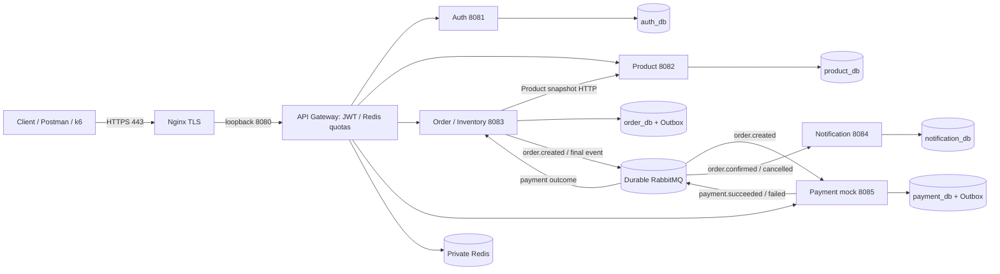
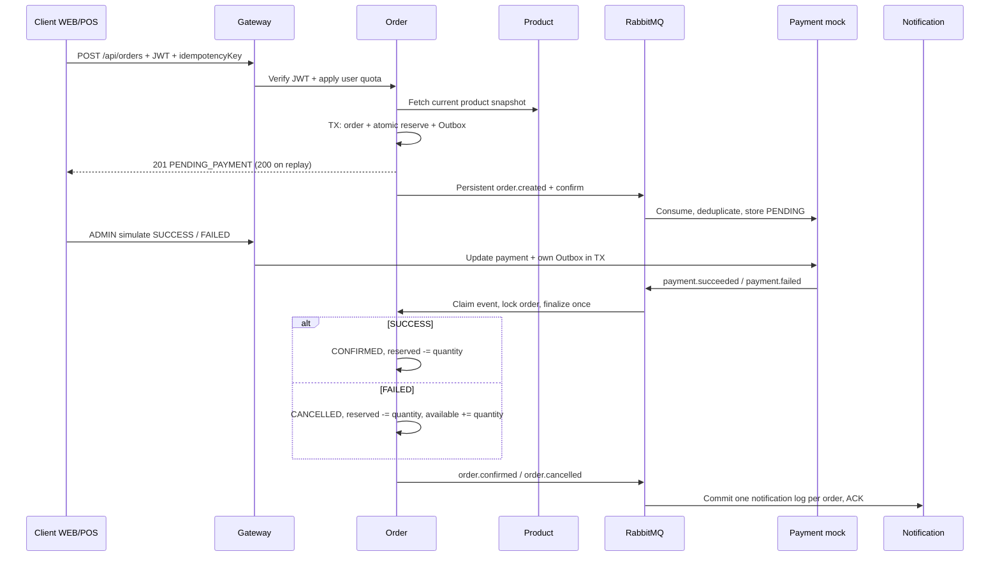

# Kiến trúc backend sáu app

Năm database nằm trong một PostgreSQL instance, mỗi service có user riêng không CONNECT sang DB khác. Inventory thuộc Order, Product chỉ quản lý catalog. Notification không có public route. Chỉ SSH/HTTP/HTTPS public; business/Actuator ports bind loopback, DB/MQ/Redis không publish trên VPS.

Transport at-least-once; Outbox retry và consumer deduplicate giữ nghiệp vụ idempotent. Không tuyên bố exactly-once transport. Payment chưa simulate giữ reservation; chưa có timeout/hủy tự động. Rollback image không rollback schema Hibernate. Một Gateway replica là single point of failure; HA cần nhiều replica/load balancer và hạ tầng DB/MQ phù hợp.

Prometheus scrape qua SSH/private network tại `/actuator/prometheus` mỗi app; Nginx không route `/actuator/**`. JVM/process/HTTP metrics đi cùng tag `application`; health không thay thế kiểm tra pending Outbox và queue/consumer. Chưa cài Prometheus/Grafana/Loki/tracing stack trên VPS 1 GiB RAM.
