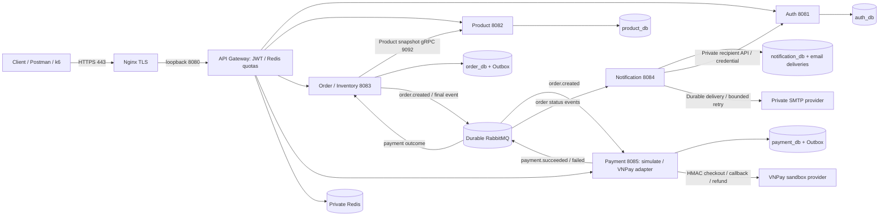
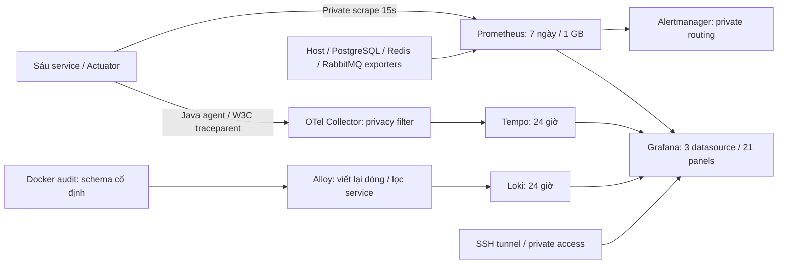

# Kiến trúc backend sáu app



Năm database nằm trong một PostgreSQL instance, mỗi service có user riêng không CONNECT sang DB khác. Inventory thuộc Order, Product chỉ quản lý catalog. Notification không có public route. Chỉ SSH/HTTP/HTTPS public; business/Actuator ports bind loopback, DB/MQ/Redis không publish trên VPS.

```mermaid
sequenceDiagram
    participant C as Client WEB/POS
    participant G as Gateway
    participant O as Order
    participant P as Product
    participant R as RabbitMQ
    participant M as Payment
    participant N as Notification
    C->>G: POST /api/orders + JWT + idempotencyKey
    G->>O: Verify JWT + apply user quota
    O->>P: gRPC: current product snapshot
    O->>O: TX: order + atomic reserve + Outbox
    O-->>C: 201 PENDING_PAYMENT (200 on replay)
    O->>R: Persistent order.created + confirm
    R->>M: Consume, deduplicate, store PENDING
    C->>G: ADMIN simulate or verified VNPay callback
    G->>M: Update payment + own Outbox in TX
    M->>R: payment.succeeded / payment.failed
    R->>O: Claim event, lock order, finalize once
    alt SUCCESS
        O->>O: CONFIRMED, reserved -= quantity
    else FAILED
        O->>O: CANCELLED, reserved -= quantity, available += quantity
    end
    O->>R: order.confirmed / order.cancelled
    R->>N: TX: deduplicate event + status log + optional email task, ACK
    N->>N: Claim email task; private Auth recipient lookup; bounded SMTP attempt
```

Transport at-least-once; Outbox retry và consumer deduplicate giữ nghiệp vụ idempotent.
Reservation có expiry; capture tới sau expiry không xác nhận lại Order mà cần đối soát refund.
Shipping/Completed do ADMIN ghi nhận, chưa tích hợp hãng vận chuyển. Notification giữ log
theo trạng thái; email có unique `(order_id,event_type)`. SMTP timeout mơ hồ hoặc crash sau
khi server nhận thư chuyển delivery sang `UNKNOWN`, không tự gửi lại. Không tuyên bố
exactly-once transport hoặc email. VNPay và SMTP mặc định tắt, cần credential private để bật.
Rollback image không rollback schema. Một Gateway replica là single point of failure;
HA cần nhiều replica/load balancer và hạ tầng DB/MQ phù hợp.

## Stack quan sát đã kiểm chứng trên CI



Nginx không route `/actuator/**` hoặc API người nhận nội bộ. Prometheus/Grafana/Tempo/
Loki/Alertmanager chỉ bind loopback; exporter nằm trong mạng Compose. Outbox và email
lưu traceparent trong transaction để nối request với tác vụ bất đồng bộ. Collector chỉ giữ
thuộc tính cho phép, loại events/status text và span có links; Alloy chỉ lưu audit đã viết lại,
không gom nguyên payload/exception. Alertmanager mặc định chưa gửi tới kênh ngoài.

Checkpoint **13/10/2026 17:10 +07**: CI head 140 đã kiểm chứng targets/history qua restart,
trace nghiệp vụ đủ sáu service, durable context, collector outage recovery và Loki privacy.
VPS đã nâng lên khoảng 4,8 GiB RAM/40 GB disk, nhưng stack quan sát chưa deploy do NTP
chưa đồng bộ. Sơ đồ thể hiện cấu hình đã kiểm chứng, không xác nhận mọi thành phần đang
chạy trên VPS. Xem [remaining-implementation](remaining-implementation.md) và nhật ký deploy.
