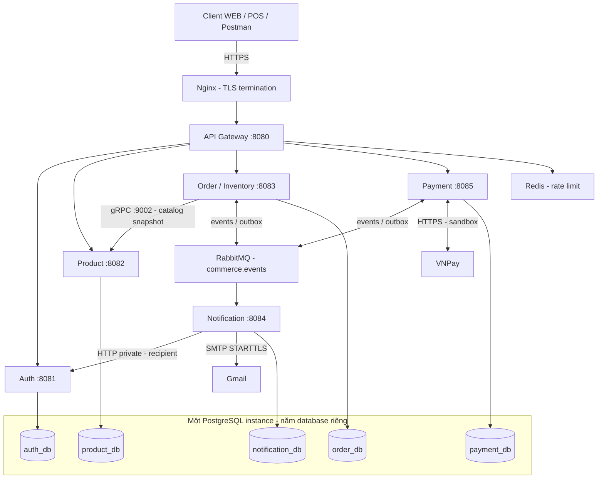
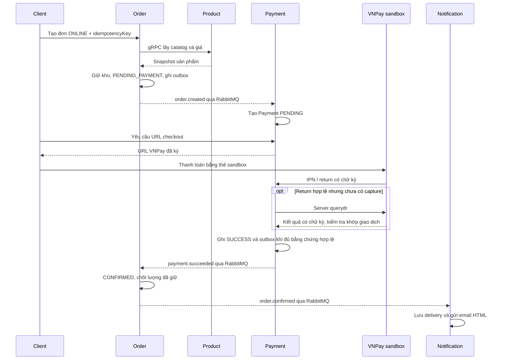

# BÁO CÁO BÀI TẬP LỚN

## Hệ thống thương mại điện tử đa kênh — Omnichannel E-Commerce

| Thông tin | Nội dung |
|---|---|
| Dự án | MD05 Rikkei Project |
| Phạm vi | Backend, tích hợp thanh toán, thông báo và hạ tầng DevOps |
| Ngày chốt báo cáo | 15/10/2026, múi giờ Việt Nam (UTC+7) |
| Mã nguồn đối chiếu | `43848df`, bao gồm phần nghiệp vụ đã tích hợp tại `8a909c99a3cf246d26da9148f5502b02f37bf8a0` |
| Kiểm tra VPS gần nhất | 17:23 ngày 15/10/2026; sáu ứng dụng healthy, restart = 0 |
| Kho mã nguồn | [dth251/md05-rikkei-project](https://github.com/dth251/md05-rikkei-project) |

Báo cáo mô tả những gì hiện có trong mã nguồn và bằng chứng kiểm thử, triển khai của dự án. Các mục “đã xây dựng”, “đã kiểm thử” và “đã chạy trên VPS” được phân biệt để tránh coi cấu hình hoặc kịch bản mô phỏng là kết quả vận hành thực tế.

## 1. Giới thiệu và mục tiêu

Dự án xây dựng backend bán hàng dùng chung cho hai kênh WEB và POS. Mục tiêu là quản lý sản phẩm, tài khoản, đơn hàng, thanh toán và tồn kho thống nhất; đồng thời thực hành giao tiếp giữa các service, xử lý bất đồng bộ và quy trình kiểm thử, triển khai tự động.

Các bài toán chính gồm:

- Hạn chế bán vượt tồn khi nhiều người đồng thời đặt cùng một sản phẩm.
- Giữ hàng trong khi khách thanh toán, xác nhận khi có kết quả hợp lệ và hoàn kho khi đơn thất bại hoặc quá hạn.
- Chống tạo đơn, ghi nhận thanh toán hoặc xử lý sự kiện lặp khi client gửi lại yêu cầu.
- Hỗ trợ thanh toán ONLINE qua VNPay sandbox và thanh toán khi nhận hàng (COD).
- Gửi email theo tiến trình xử lý đơn; quản lý giao hàng, trả hàng và hoàn tiền.
- Đóng gói từng service, chạy CI/CD, triển khai HTTPS trên VPS và theo dõi tình trạng hệ thống.

WEB/POS hiện được biểu diễn bằng trường `channel` trong API và được demo qua Postman. Dự án chưa có giao diện cửa hàng hoặc phần mềm quầy thu ngân; chưa phải một sản phẩm thương mại điện tử hoàn chỉnh dành cho người dùng cuối.

## 2. Kiến trúc hệ thống

### 2.1. Kiến trúc tổng thể

Hệ thống được tổ chức thành sáu ứng dụng độc lập theo hướng microservices. Mỗi ứng dụng có Gradle Wrapper, cấu hình, Docker image và trách nhiệm riêng. Gateway tiếp nhận HTTP từ bên ngoài; các service nghiệp vụ trao đổi đồng bộ khi cần dữ liệu ngay và bất đồng bộ khi đồng bộ trạng thái giao dịch.

Các cổng trên là cổng ứng dụng; không có nghĩa tất cả được mở ra Internet. Production đi qua Nginx/Gateway; Notification không có route API công khai. gRPC 9002 chỉ dùng trong mạng Docker riêng.

### 2.2. Trách nhiệm của từng service

| Service | Trách nhiệm chính | Dữ liệu sở hữu |
|---|---|---|
| API Gateway | Định tuyến, kiểm tra JWT, giới hạn lưu lượng bằng Redis, xử lý request ID và lỗi upstream | Không có database nghiệp vụ |
| Auth | Đăng ký, đăng nhập, phân quyền USER/ADMIN, refresh/logout, địa chỉ người dùng | Tài khoản, phiên refresh, địa chỉ |
| Product | Quản lý danh mục, tìm kiếm/lọc, sản phẩm và biến thể; cung cấp catalog qua HTTP/gRPC | Sản phẩm, SKU, giá và thuộc tính biến thể |
| Order / Inventory | Tạo đơn WEB/POS, giữ/chốt/hoàn kho, hết hạn, giao hàng, hồ sơ trả hàng | Đơn và dòng hàng, snapshot, tồn kho, hồ sơ trả, inbox/outbox |
| Payment | Vòng đời thanh toán ONLINE/COD, VNPay sandbox, biên nhận thu/hoàn và đối soát | Payment, giao dịch VNPay, biên nhận, inbox/outbox |
| Notification | Tiếp nhận sự kiện, ghi nhận thông báo và gửi email HTML | Nhật ký thông báo, email delivery và trạng thái xử lý |

Tồn kho thuộc **Order**, không thuộc Product. Cách tổ chức này cho phép lưu đơn, cập nhật lượng giữ và ghi outbox trong cùng transaction cục bộ. Product cung cấp thông tin hàng hóa và giá; Order lưu snapshot để đơn cũ không thay đổi theo giá hoặc tên sản phẩm mới.

### 2.3. Dữ liệu và cách giao tiếp

Năm service nghiệp vụ sử dụng năm database và tài khoản PostgreSQL riêng. Cấu hình hiện tại đặt chúng trong **một PostgreSQL instance**, chưa phải năm cụm cơ sở dữ liệu độc lập hay hệ thống có tính sẵn sàng cao. Service không đọc trực tiếp database của service khác.

- **HTTP/REST:** client gọi API qua Gateway; Notification lấy địa chỉ email qua API private của Auth.
- **gRPC/Protocol Buffers:** Order lấy thông tin sản phẩm từ Product theo batch, có kiểm tra hợp đồng và deadline. Hai service tự sở hữu proto/generated code, không dùng module shared.
- **RabbitMQ:** truyền các sự kiện như `order.created`, `payment.succeeded`, `order.confirmed` và sự kiện trả hàng. Trạng thái giữa các service nhất quán sau khi sự kiện được xử lý, không bắt buộc thay đổi cùng thời điểm.

Saga được triển khai theo kiểu choreography: mỗi service xử lý sự kiện trong phạm vi của mình và phát sự kiện tiếp theo. Order/Payment ghi outbox cùng transaction với thay đổi nghiệp vụ, sau đó publisher gửi message persistent với publisher confirms. Consumer dùng inbox/khóa duy nhất để chống xử lý lặp, ACK sau commit; có retry, dead-letter queue và công cụ phục hồi.

Cơ chế này hướng tới giao nhận **ít nhất một lần** và xử lý nghiệp vụ idempotent. Dự án không tuyên bố RabbitMQ hoặc SMTP bảo đảm “exactly once”, và không sử dụng transaction phân tán hai pha giữa các database.

## 3. Công nghệ sử dụng

| Nhóm | Công nghệ / phiên bản trong dự án | Mục đích |
|---|---|---|
| Ngôn ngữ, build | Java 21; Gradle 8.9, Groovy DSL và Wrapper riêng từng service | Xây dựng, kiểm thử và đóng gói ứng dụng |
| Backend | Spring Boot 3.5.6; Spring MVC | REST API cho service nghiệp vụ |
| Gateway | Spring Cloud 2025.0.3; Spring Cloud Gateway WebFlux | Cổng vào, định tuyến và quota |
| Truy cập dữ liệu | Spring Data JPA/Hibernate, JDBC; PostgreSQL 17 | Lưu trữ, transaction, locking và truy vấn có điều kiện |
| Bảo mật | Spring Security, JWT, BCrypt; JJWT 0.12.6 tại các module sử dụng | Xác thực, phân quyền, bảo vệ mật khẩu |
| Giao tiếp đồng bộ | gRPC Java 1.84.1; Protobuf 3.25.9 | Hợp đồng catalog giữa Product và Order |
| Message broker | RabbitMQ 4.1; Spring AMQP | Sự kiện nghiệp vụ, retry và DLQ |
| Giới hạn lưu lượng | Redis 7 | Bộ đếm quota của Gateway; chưa dùng làm cache catalog |
| Thanh toán | VNPay sandbox; HMAC và HTTPS | Checkout, IPN/return, truy vấn và yêu cầu hoàn tiền |
| Email | Spring Mail/Jakarta Mail; Gmail SMTP; GreenMail và Mailpit cho kiểm thử | Email HTML và bản text dự phòng |
| Hợp đồng API | OpenAPI; springdoc 2.8.17; Postman | Mô tả và demo API |
| Kiểm thử | JUnit 5, Spring Boot Test, Spring Security Test, H2 và PostgreSQL thật trong live tests; k6 | Kiểm thử đơn vị, tích hợp, bảo mật và tải |
| Triển khai | Docker, Docker Compose, Nginx, HTTPS, VPS Linux | Đóng gói và vận hành |
| CI/CD | GitHub Actions; GitHub Container Registry; SSH | Kiểm thử, publish image theo SHA và rollout từng service |
| Metrics | Actuator, Micrometer, Prometheus, Grafana và exporters | HTTP, JVM, tài nguyên, broker, outbox và email |
| Trace/log/alert | OpenTelemetry, Collector, Tempo, Alloy, Loki, Alertmanager | Đã có cấu hình và kiểm thử; chưa triển khai trên VPS tại mốc báo cáo |

Mã nguồn tuân theo các lớp controller, service interface/implementation, repository, DTO request/response và mapper. Mỗi service tự sở hữu security và error handler; response API theo cấu trúc `ApiResponse`. Các thay đổi schema dùng SQL/script vận hành của dự án, không sử dụng Flyway hoặc Liquibase.

## 4. Các luồng nghiệp vụ chính

### 4.1. Đặt hàng và thanh toán ONLINE

IPN là thông báo từ máy chủ VNPay về máy chủ của dự án. Backend cần xác minh chữ ký và nội dung giao dịch để ghi nhận thanh toán, không có bước chờ ADMIN duyệt một giao dịch ONLINE thành công. Return là lần trình duyệt quay về dự án; chỉ việc quay về hoặc tham số hiển thị thành công chưa đủ để tự đổi trạng thái.

Bản sửa hiện tại bổ sung truy vấn server-to-server khi return hợp lệ nhưng backend chưa ghi nhận capture. Payment chỉ xác nhận sau khi kết quả nhà cung cấp hợp lệ và khớp thông tin giao dịch. Callback/refresh trùng đi qua cơ chế idempotent, tránh phát thêm một lần thanh toán thành công.

### 4.2. Giữ hàng và đơn quá hạn

Đơn ONLINE giữ hàng **200 giây**. Khi tạo đơn, `available` giảm và `reserved` tăng ngay cả khi trạng thái vẫn là `PENDING_PAYMENT`. Khi thanh toán thành công trong hạn, hệ thống giảm `reserved`, không trừ `available` lần thứ hai. Khi hết hạn/thất bại, lượng đang giữ được trả về kho một lần.

| Thời điểm ví dụ: mua 2 sản phẩm | Trạng thái đơn | Available | Reserved |
|---|---|---:|---:|
| Trước khi tạo đơn | Chưa có đơn | 19 | 0 |
| Tạo đơn chờ thanh toán | PENDING_PAYMENT | 17 | 2 |
| Nếu thanh toán thành công trong hạn | CONFIRMED | 17 | 0 |
| Hoặc nếu hết hạn mà chưa thanh toán | EXPIRED | 19 | 0 |

Scheduler xử lý theo chu kỳ nên có thể quan sát trạng thái hết hạn sau mốc 200 giây một khoảng ngắn. Capture đến muộn không được hồi sinh đơn đã hết hạn và đã trả kho; phải xử lý theo luồng hoàn tiền để tránh xác nhận một đơn không còn hàng giữ.

### 4.3. COD, giao hàng và hoàn tất

COD được tạo ở trạng thái Order `CONFIRMED`, Payment `PENDING`; điều này chưa chứng minh đã thu tiền. ADMIN chuyển đơn sang `SHIPPING`, ghi đơn vị vận chuyển/mã theo dõi, sau đó xác nhận đã thu đủ tiền bằng API có biên nhận. Payment chuyển `SUCCESS`; Order chỉ được hoàn tất khi đã nhận acknowledgement thu tiền.

Các bước giao hàng và thu tiền hiện là nghiệp vụ do ADMIN thao tác, chưa tích hợp hãng vận chuyển hay tự xác minh dòng tiền mặt. API lưu người thực hiện, thời gian và biên nhận để truy vết.

### 4.4. Trả hàng và hoàn tiền

Hệ thống hỗ trợ trả **toàn bộ đơn** sau khi hoàn tất: yêu cầu trả → ADMIN duyệt/từ chối → xác nhận nhận hàng → chờ hoàn tiền → hoàn tiền. Nếu `restock=true`, hàng nhận lại được cộng vào `available` đúng một lần.

`REFUND_PENDING` nghĩa là hồ sơ đang chờ kết quả hoàn tiền, dù hàng có thể đã nhập lại kho. Đây không phải trạng thái đã hoàn tiền. Với VNPay, cần gửi yêu cầu hoàn bằng API ADMIN và đối soát khi kết quả chưa rõ; chỉ bằng chứng hợp lệ của giao dịch hoàn tiền mới cho phép ghi hoàn tất. Truy vấn thành công của giao dịch thanh toán gốc không chứng minh đã hoàn tiền.

Chưa có scheduler tự đối soát hoàn tiền định kỳ; phải dùng API reconcile khi cần. Khoảng giữ hàng 200 giây không phải thời hạn xử lý hoàn tiền. Trạng thái Payment của khoản thu gốc vẫn có thể là `SUCCESS`, trong khi `refundStatus` phản ánh kết quả hoàn; hồ sơ trả hàng chuyển `REFUNDED` sau sự kiện tương ứng. Chưa có bằng chứng hoàn VNPay sandbox thực tế thành công tại mốc báo cáo.

### 4.5. Thời điểm gửi email

| Email | Điều kiện phát sinh |
|---|---|
| Xác nhận đơn ONLINE | Order xác nhận sau kết quả thanh toán hợp lệ |
| Xác nhận ở luồng COD hiện tại | Order nhận xác nhận đã thu tiền COD; không gửi ngay khi vừa tạo COD |
| Đơn bị hủy | Xử lý sự kiện hủy đơn |
| Đơn hết hạn | ONLINE quá thời gian giữ hàng và phát sự kiện hết hạn |
| Đang giao / hoàn tất | ADMIN chuyển đơn sang SHIPPING / COMPLETED |

Email được xử lý bất đồng bộ nên không bảo đảm đến ngay cùng lúc response API. Nội dung thật có mã đơn, trạng thái và bố cục HTML, kèm text dự phòng. Dự án chưa gửi email riêng cho yêu cầu trả/hoàn tiền, chưa sinh hóa đơn PDF hoặc hóa đơn điện tử. Mẫu hóa đơn minh họa trong thư mục tài liệu không đồng nghĩa email thật đã có đầy đủ dòng hàng và nghiệp vụ hóa đơn.

## 5. Những phần đã làm được

| Nhóm chức năng | Kết quả hiện có | Giới hạn cần hiểu đúng |
|---|---|---|
| Tài khoản và phiên | Đăng ký/login, hash mật khẩu, JWT USER/ADMIN, refresh rotation, phát hiện replay và logout phiên; quản lý địa chỉ | Access JWT đã phát chưa bị thu hồi tức thì khi logout |
| Bảo vệ API | Kiểm tra quyền ở Gateway và service; ownership; chống giả header định danh; quota Redis | Chưa có MFA/SSO; quota không thay thế khả năng chịu tải |
| Catalog | CRUD quản trị, SKU, biến thể, tìm kiếm/lọc/sắp xếp/phân trang và ngừng bán | Chưa có công cụ tìm kiếm chuyên biệt hoặc cache catalog phân tán |
| Đơn hàng | WEB/POS dùng chung API/kho, snapshot giá, idempotency và kiểm soát trạng thái | Chưa có giao diện bán hàng; chưa có giỏ hàng/khuyến mãi hoàn chỉnh |
| Tồn kho | Giữ/chốt/hoàn kho có transaction và kiểm tra đồng thời, hạn chế oversell | Chưa có quản lý nhiều kho, chuyển kho hoặc phân bổ theo chi nhánh |
| Thanh toán | Mô phỏng cho kiểm thử; COD; VNPay sandbox checkout, callback, query và refund/reconcile API | Không phải tích hợp merchant production đã nghiệm thu |
| Giao/hoàn tất | ADMIN ghi vận chuyển và điều khiển vòng đời đơn | Chưa đồng bộ tự động với hãng giao nhận |
| Trả hàng | Duyệt/từ chối, biên nhận nhập kho, restock một lần, trạng thái chờ/đã hoàn | Chỉ toàn đơn; chưa hoàn từng dòng hoặc một phần số tiền |
| Thông báo | Năm loại email trạng thái, HTML/text, delivery bền vững, retry và chống xử lý lặp | Chưa có SMS/push; trường hợp SMTP không rõ kết quả cần đối soát |
| Độ tin cậy sự kiện | Outbox/inbox, publisher confirms, retry/DLQ và phục hồi | Eventual consistency; phải theo dõi backlog và lỗi nghiệp vụ |
| API và demo | OpenAPI, Postman, kịch bản Java live tests và k6 | Collection demo không thay thế unit/integration tests |
| DevOps | Image theo SHA, CI/CD từng service, HTTPS VPS, health/smoke, metrics và dashboard | Một VPS; chưa có HA hoặc cam kết zero downtime |

## 6. Kiểm thử và bằng chứng thực tế

### 6.1. Kiểm thử tự động

Các tầng kiểm thử gồm Java unit tests, kiểm thử Spring/security, kiểm thử tích hợp với PostgreSQL/RabbitMQ/Gateway thật, SMTP qua GreenMail/Mailpit, hợp đồng gRPC, kịch bản phục hồi và k6. CI có các ca callback trùng/đồng thời, hết hạn, trả kho, outbox khi broker lỗi, restart và refund bằng provider fixture.

Đợt sửa thanh toán, kho 200 giây và email HTML gần nhất ghi nhận:

| Service được sửa | Java tests đạt | Kết quả đóng gói |
|---|---:|---|
| Payment | 70 | bootJar đạt |
| Order | 61 | bootJar đạt |
| Notification | 22 | bootJar đạt |
| Tổng của ba service trong đợt sửa | **153** | Không failure, error hoặc skipped |

Con số 153 chỉ là bộ kiểm thử của ba service trong đợt sửa, không phải tổng số test toàn repository. [Bằng chứng chi tiết](evidence/vnpay-pending-recovery-2026-10-15.json).

PR #38 đã được tích hợp sau khi CI đạt. Kiểm tra bổ sung ngày 15/10 xác nhận [pipeline main 38631145755](https://github.com/dth251/md05-rikkei-project/actions/runs/38631145755) kết thúc **success**, head `8a909c99a3cf246d26da9148f5502b02f37bf8a0`. Kết quả này cập nhật checkpoint cũ vốn ghi pipeline main còn đang chạy.

### 6.2. Demo trên hệ thống đã triển khai

- **Thanh toán VNPay NCB sandbox:** đơn #176 / Payment #107, giá trị 125.000 đồng; trang return hiển thị “Thanh toán thành công”, API/database ghi Order `CONFIRMED`, Payment `SUCCESS`. Kho từ 20 còn 19, reserved = 0; refresh không tạo thêm sự kiện thành công. [Ảnh kết quả](evidence/vnpay-fixed-success-2026-10-15.png).
- **Đơn không thanh toán:** đơn #177 giữ hai sản phẩm, kho từ 19/0 thành 17/2; ở giây 155 vẫn chờ. Sau 200 giây, quan sát ở giây 202,94 cho thấy Order `EXPIRED`, Payment `FAILED`, kho trở lại 19/0.
- **Email Gmail thật:** đã đối chiếu thư xác nhận #176 và hết hạn #177 trong inbox; có cả HTML và text. Database mỗi đơn ghi một delivery `SENT`, attempts = 1. [Bằng chứng tổng hợp](evidence/vnpay-pending-recovery-2026-10-15.json).

Các ca này chứng minh thanh toán sandbox, xử lý kho và gửi Gmail ở những tình huống đã thử. Chúng chưa chứng minh IPN được đăng ký/giao nhận độc lập thành công trong mọi tình huống, hoàn tiền provider thực tế hay khả năng chịu tải sản xuất.

### 6.3. Kết quả kiểm thử tải và giới hạn năng lực

Phép đo ngày 14/10 dùng 50 tài khoản thật, gọi catalog qua HTTPS trên VPS một CPU, RAM khoảng 4,8 GiB; target 500 rồi 1.000 iterations/giây, mỗi mức 10 giây, tối đa 200 VU và timeout 3 giây.

| Chỉ số | Target 500/s | Target 1.000/s |
|---|---:|---:|
| Requests thực sự phát | 800 | 800 |
| Request rate theo k6 summary | 63,03/s | 64,54/s |
| HTTP 200 | 9 | 0 |
| Successful throughput | 0,71/s | 0/s |
| Tỷ lệ request lỗi | 98,875% | 100% |
| Dropped iterations | 4.201 | 9.200 |
| CPU lớn nhất | 100% | 100% |
| Threshold | Không đạt | Không đạt |

**Chưa đạt mục tiêu 500 hoặc 1.000 request/giây.** Target là mức yêu cầu của kịch bản, không phải throughput thành công. CPU bão hòa nhưng chưa có profiling đủ để quy nguyên nhân cho service cụ thể. Kết quả này cũng chưa xác định được công suất tối đa ở tải vừa phải; cần đo tăng dần và đối chiếu giao dịch thành công. Xem [điều kiện, số liệu và cách diễn giải phép đo](capacity-monitoring-report.md).

## 7. Triển khai, vận hành và bảo mật

### 7.1. Quy trình CI/CD

Luồng triển khai: nhánh `feature/...` → kiểm thử/build → Pull Request → merge `main` → publish image GHCR theo full Git SHA → SSH rollout từng service → kiểm tra health và smoke. Mỗi service có tag riêng, cho phép triển khai độc lập; không dùng `latest` để xác định release.

Script có khóa rollout, lưu manifest/release và phục hồi image cũ khi rollout thất bại. Đây là rollback ứng dụng; chưa phải rollback schema hoặc dữ liệu. Không xóa volume để triển khai lại. Chi tiết tại [quy trình CI/CD](ci-cd.md) và [nhật ký commit/triển khai](commits-and-deployments.md).

### 7.2. Trạng thái vận hành tại mốc báo cáo

Kiểm tra read-only lúc **17:23 ngày 15/10/2026** xác nhận:

- Cả sáu ứng dụng chạy image `8a909c99a3cf246d26da9148f5502b02f37bf8a0`, healthy và restart = 0.
- Order có `RESERVATION_TTL=PT200S`.
- PostgreSQL, RabbitMQ, Redis, Prometheus, Grafana và Mailpit đang chạy; các container có healthcheck báo healthy. Node/PostgreSQL/Redis exporters cũng đang chạy.
- VPS có một CPU, RAM tổng 4.926 MiB; đây là môi trường dùng chung tài nguyên cho nhiều JVM và hạ tầng.
- Chưa thấy Collector/Tempo/Loki/Alloy/Alertmanager trong danh sách container của deployment này.

[Snapshot kiểm tra báo cáo](evidence/report-system-audit-2026-10-15.json) lưu thời điểm, revision và trạng thái đã quan sát, không chứa cấu hình bí mật. Trạng thái healthy phản ánh healthcheck tại thời điểm kiểm tra, không bảo đảm mọi giao dịch hoặc dependency luôn hoạt động.

### 7.3. Quan sát hệ thống

Prometheus/Grafana đã triển khai; bộ kiểm chứng trước đó xác nhận sáu target ứng dụng, năm target hạ tầng và dashboard 22 panel. Dashboard theo dõi HTTP, lỗi/429, JVM/GC, CPU/RAM, outbox, RabbitMQ, email và xử lý hết hạn. [Báo cáo monitoring](capacity-monitoring-report.md) ghi điều kiện và kết quả cụ thể.

Distributed tracing và logging tập trung đã có cấu hình, kiểm thử truyền trace context qua HTTP/RPC/event và lọc thông tin nhạy cảm. Chúng chưa chạy trên VPS tại mốc kiểm tra này. Rule cảnh báo đã có kiểm thử, nhưng chưa có bằng chứng gửi cảnh báo đến một kênh nhận bên ngoài.

### 7.4. Các biện pháp bảo vệ đã có

Mật khẩu được hash; API kiểm tra JWT/quyền và ownership; Gateway loại bỏ header định danh do client giả mạo. VNPay callback/query được xác minh chữ ký và dữ liệu. Secret được truyền bằng cấu hình private, không đưa vào mã nguồn/báo cáo. Các cổng database, broker và endpoint quản trị không mở trực tiếp ra Internet.

Giới hạn hiện tại gồm access JWT chưa thu hồi tức thì, gRPC plaintext trong mạng Docker và hạ tầng chỉ có một node. Nếu tách service sang nhiều máy cần bổ sung TLS/mTLS cho giao tiếp nội bộ và đánh giá lại mô hình tin cậy. Dự án chưa có bằng chứng kiểm toán bảo mật độc lập.

## 8. Những phần chưa làm được hoặc chưa đủ bằng chứng

| Hạng mục | Trạng thái thực tế | Hướng hoàn thiện |
|---|---|---|
| Frontend WEB/POS | Chưa xây dựng; demo bằng API | Phát triển trong phạm vi được phê duyệt tiếp theo; không thuộc phạm vi repository hiện tại |
| Merchant VNPay production | Đang dùng sandbox | Hoàn tất đăng ký, cấu hình và nghiệm thu môi trường thật |
| IPN độc lập | Có handler và test, chưa kiểm chứng độc lập việc đăng ký/giao nhận tại provider | Đối chiếu cấu hình merchant, delivery và log theo reference |
| Hoàn tiền VNPay thật | Có state machine/API/test fixture; chưa có bằng chứng provider hoàn thành thực tế | Thử hoàn sandbox và đối chiếu giao dịch hoàn, không ép trạng thái bằng dữ liệu giả |
| Tự động đối soát refund | Chưa có job định kỳ | Bổ sung scheduler có giới hạn, chống gửi lại và cơ chế xử lý ngoại lệ |
| Trả/hoàn một phần | Chỉ hỗ trợ toàn đơn | Thiết kế theo dòng hàng, số lượng và số tiền còn có thể hoàn |
| Email trả/hoàn, hóa đơn | Chưa có email riêng và hóa đơn nghiệp vụ | Bổ sung template, sự kiện và dữ liệu hóa đơn phù hợp |
| Logistics, đa kho | Thao tác vận chuyển thủ công; một nguồn tồn dùng chung | Tích hợp hãng vận chuyển, chi nhánh/kho và đối soát |
| Các tiện ích bán hàng | Chưa có giỏ hàng, khuyến mãi, tích điểm hoàn chỉnh | Xây dựng hợp đồng và vòng đời nghiệp vụ trước khi mở rộng |
| Trace/log/alert trên VPS | Đã cấu hình/kiểm thử, chưa triển khai đủ; thiếu kênh nhận alert | Rollout có kiểm tra tài nguyên, privacy, retention và gửi thử cảnh báo |
| Hiệu năng | Tải 500/1.000 không đạt; chưa xác định capacity bền vững | Profile, tối ưu truy vấn/JVM/TLS và đo tăng dần với tiêu chí rõ ràng |
| Tính sẵn sàng cao | Một VPS, một instance database/broker | Thiết kế replication, failover, cân bằng tải và diễn tập sự cố |
| Khôi phục thảm họa | Có lưu volume và rollback image; chưa có bằng chứng backup/restore đạt RPO/RTO | Lập lịch backup, lưu bản sao ngoài máy và diễn tập restore |
| Nghiệm thu bảo mật | Đã có test quyền và privacy; chưa pentest độc lập | Bổ sung rà soát bảo mật và quy trình quản lý khóa/token |

Các mục trên phân biệt phần chưa lập trình với phần đã có mã nguồn nhưng chưa triển khai hoặc chưa chứng minh được bằng thử nghiệm thực tế. Không nên dùng kết quả unit test để kết luận một tích hợp bên ngoài hoặc yêu cầu vận hành đã hoàn thành.

## 9. Kịch bản gợi ý để báo cáo và demo

1. Giới thiệu sơ đồ sáu service, quyền sở hữu dữ liệu và vai trò của RabbitMQ/gRPC.
2. Import [collection luồng chính](../tests/postman/md05-luong-chinh.postman_collection.json); đăng nhập USER/ADMIN bằng tài khoản demo được cấp riêng. Xem [hướng dẫn](test-luong-chinh.md).
3. Xem/tạo sản phẩm và tồn kho; tạo đơn ONLINE, đối chiếu `available/reserved` ngay khi còn chờ.
4. Thanh toán bằng VNPay sandbox; kiểm tra trang return, Payment `SUCCESS`, Order `CONFIRMED` và email HTML. Dùng thông tin thẻ test trong hướng dẫn sandbox, không dùng thẻ thật.
5. Tạo một đơn ONLINE khác và không thanh toán; chờ hơn 200 giây, kiểm tra EXPIRED/FAILED và lượng kho đã được trả.
6. Trình bày COD, giao/hoàn tất và trả hàng; giải thích rõ `REFUND_PENDING` chưa đồng nghĩa đã hoàn tiền. Không dùng endpoint mô phỏng làm bằng chứng VNPay đã hoàn thực tế.
7. Mở dashboard và pipeline CI/CD, trình bày kết quả tải không đạt cùng hướng cải thiện.

Khi demo nên dùng sản phẩm và đơn mới, giữ lại ID để đối chiếu xuyên suốt; không xóa dữ liệu hoặc thay timestamp nhằm làm kịch bản đạt. Không đưa mật khẩu, JWT, merchant secret hoặc khóa SSH vào slide, ảnh chụp và tài liệu nộp.

## 10. Đánh giá kết quả và hướng phát triển

Dự án đã xây dựng được nền tảng backend phân tách trách nhiệm, có giao dịch cục bộ và xử lý bất đồng bộ cho chuỗi đặt hàng–thanh toán–tồn kho–thông báo. Kết quả nổi bật là cơ chế giữ/hoàn kho có chống lặp, thanh toán VNPay sandbox thành công trên hệ thống đã triển khai, Gmail HTML, kiểm thử nhiều tầng và CI/CD theo service.

Giới hạn lớn nhất ở giai đoạn này là năng lực chịu tải chưa đạt mục tiêu, vận hành tập trung trên một VPS và một số tích hợp chỉ mới được kiểm thử bằng fixture. Thứ tự phát triển phù hợp là chốt bằng chứng IPN/refund, hoàn thiện quan sát và khôi phục dữ liệu, xác định capacity bằng profiling/đo tải, sau đó mới mở rộng nghiệp vụ và quy mô triển khai.

## 11. Tài liệu đối chiếu

- [Hợp đồng API](api-contract.md), [OpenAPI](openapi.md).
- [Catalog gRPC Product–Order](product-order-grpc.md).
- [VNPay sandbox](vnpay-sandbox.md), [demo trên trình duyệt](vnpay-sandbox-browser.md).
- [COD](cod-payment.md), [giao hàng/hoàn tất](order-fulfillment.md), [trả hàng/hoàn tiền](returns-refunds.md).
- [Email và monitoring hết hạn](expiry-email-monitoring.md), [mẫu email thật](email/order-notification-preview.html).
- [Kết quả monitoring/tải](capacity-monitoring-report.md), [triển khai bổ sung và giới hạn kiểm chứng](remaining-implementation.md).
- [Workflow CI/CD](../.github/workflows/ci.yml), [Compose nền tảng](../docker-compose.yml), [nhật ký SHA/kiểm thử/deploy](commits-and-deployments.md).

Một số tài liệu đối chiếu lưu checkpoint lịch sử, có thể còn nhắc TTL 150 giây hoặc trạng thái triển khai cũ. Báo cáo này dùng TTL 200 giây và snapshot ngày 15/10/2026; khi cần kiểm tra một kết quả phải đối chiếu đúng ngày và SHA.
