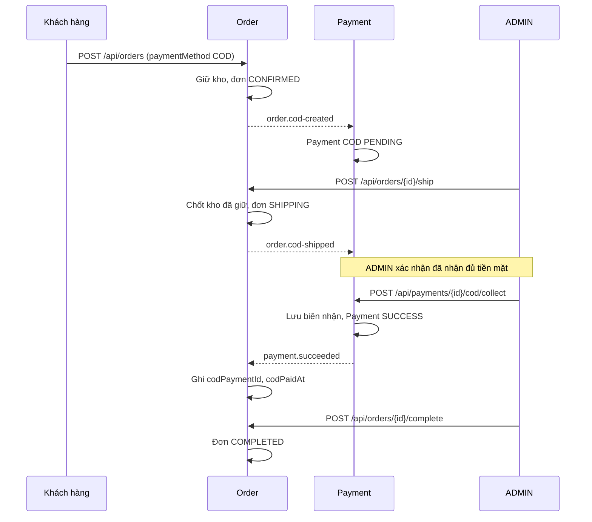

# Thanh toán khi nhận hàng (COD)

Client chọn `paymentMethod: "COD"` khi tạo đơn. Bỏ trường này hoặc chọn
`ONLINE` giữ luồng hiện có, bao gồm VNPay và simulate phục vụ kiểm thử.
Không đổi phương thức sau khi tạo đơn; dùng lại idempotency key với phương
thức khác trả 409. COD yêu cầu đầy đủ địa chỉ giao hàng.



## API và phân quyền

Tất cả API đi qua Gateway; Order/Payment kiểm tra JWT và quyền riêng.
Chủ đơn hoặc ADMIN được xem đơn/payment; người khác nhận 404.

| Thao tác | API | Quyền / điều kiện |
|---|---|---|
| Tạo COD | `POST /api/orders` | USER; thêm paymentMethod COD và shippingAddress |
| Tra payment | `GET /api/payments/by-order/{orderId}` | Chủ đơn/ADMIN; 404 khi chưa nhận creation |
| Giao hàng | `POST /api/orders/{id}/ship` | ADMIN; CONFIRMED; body carrier/trackingNumber |
| Thu tiền | `POST /api/payments/{id}/cod/collect` | ADMIN; COD PENDING; đã nhận event giao hàng |
| Hoàn tất | `POST /api/orders/{id}/complete` | ADMIN; SHIPPING và đã nhận event thu tiền |
| Hủy trước giao | `POST /api/orders/{id}/cod/cancel` | ADMIN; COD CONFIRMED; không có body |

Ví dụ body tạo đơn:

```json
{
  "channel": "WEB",
  "paymentMethod": "COD",
  "idempotencyKey": "cod-order-001",
  "items": [{"productId": 1, "quantity": 2}],
  "shippingAddress": {
    "recipientName": "Nguyen Van A", "phone": "0901234567",
    "street": "12 Duong A", "ward": "Phuong A",
    "district": "Quan B", "province": "Thanh pho C"
  }
}
```

Body thu tiền:

```json
{
  "amount": 250000.00,
  "idempotencyKey": "cod-collection-001",
  "receiptNumber": "COD-RECEIPT-001"
}
```

Amount phải bằng toàn bộ tổng tiền payment. Mỗi lần thu lưu số biên nhận,
ADMIN thực hiện và thời gian server; response có `paymentMethod` và
`codReceipt` (`receiptNumber`, `collectedBy`, `collectedAt`). Key thu tiền
và số biên nhận duy nhất trong Payment. Replay cùng payment/key/biên
nhận/số tiền/người thu trả 200 với biên nhận gốc; đổi nội dung trả 409.
Không hỗ trợ thu một phần hoặc ghi đè biên nhận đã thu.

Order response thêm `paymentMethod`, `codPaymentId`, `codPaidAt`.
CONFIRMED chỉ có nghĩa đơn được chấp nhận để xử lý; SHIPPING chưa chứng
minh đã thu tiền. Gọi complete trước acknowledgement nhận 409; poll GET
rồi gọi lại. Collect có thể trả 409 ngay sau ship trong lúc Payment chưa
xử lý event giao hàng. Giá và địa chỉ vẫn là snapshot bất biến.

## Kho và event

- Tạo: giảm available, tăng reserved. Giao: giảm reserved đúng một lần,
  không giảm available thêm. Hủy trước giao: trả reserved về available
  đúng một lần; Order CANCELLED, Payment chuyển FAILED và phát payment.failed.
- Không cho hủy bằng endpoint COD khi đã giao. Trả hàng, từ chối nhận hàng,
  đối soát hãng vận chuyển và hoàn tiền cần quy trình riêng, chưa có ở đây.
  ADMIN chỉ collect khi cửa hàng thực sự nhận tiền; API không xác minh tiền
  mặt thực tế hoặc tự liên lạc hãng vận chuyển.
- COD không dùng timeout 30 phút của ONLINE; giữ kho đến khi ADMIN giao/hủy.
  Simulate và VNPay checkout không thể đánh dấu COD đã trả tiền.

Event giữ CommerceEvent của từng service, không thêm shared module hay đổi
payload ONLINE. order.cod-created dùng payment.order-created.q;
order.cod-shipped/order.cod-cancelled dùng payment.cod-lifecycle.q với DLQ
và policy riêng. Projection cod_deliveries xử lý lifecycle đến trước hoặc
sau creation bằng cùng advisory lock theo orderId. Khác user/amount/phương
thức/state bị từ chối. Inbox chống gửi lại; row lock và transaction gộp
thay đổi dữ liệu với Outbox.

Notification tiếp tục nhận order.shipped/order.completed để ghi lịch sử.
Sau thu COD, Order phát order.confirmed kèm paymentId để ghi terminal
notification/email theo contract hiện tại; event này không đổi SHIPPING
thành CONFIRMED. Hủy được thông báo sau acknowledgement FAILED của Payment.
Email phụ thuộc cấu hình SMTP hiện có.

## Rollout và kiểm thử

Migration mới: Order 004-cod-payment.sql, Payment 002-cod-payment.sql.
Hàng cũ mặc định ONLINE; không sửa migration đã checksum, không xóa volume.
Chạy runner schema, provision topology, triển khai Payment trước Order;
CI đặt Payment trước Order trong danh sách rollout. Không rollback Order
về bản chưa hỗ trợ COD khi còn đơn COD đang xử lý.

Java tests phủ quyền, số tiền, replay/unique biên nhận, tranh chấp giao/hủy
và thu tiền, kho, chống simulate/VNPay, acknowledgement, lifecycle đến trước
creation. Live tests dùng PostgreSQL, RabbitMQ và HTTP qua Gateway. Fixture
có tiền tố COD, không phải giao dịch thật. SHA/kết quả/deploy trong
[nhật ký](commits-and-deployments.md).
