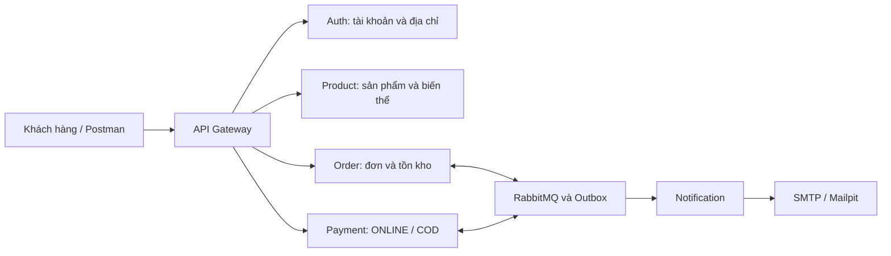

# Demo các luồng hoạt động MD05 bằng Postman

Kịch bản ngày 14/10/2026, dùng [bộ Postman tiếng Việt](../tests/postman/README.md). Dành khoảng 25–30 phút cho bài đầy đủ; phần VNPay, sự cố và tải là bài riêng. Mỗi bước dưới đây là kết quả mong đợi, không phải kết quả đã chạy của phiên trình bày.

## Chuẩn bị

1. Khởi động stack đã cấu hình; Gateway local `http://127.0.0.1:8080`. Import collection nghiệp vụ và environment mẫu, chọn environment, điền ADMIN private được cấp sẵn.
2. Runner: Iterations 1, Delay 1000 ms, dừng khi lỗi. Dùng một environment cho cả phiên. Không dùng ID của collection production trong bộ này.
3. Mở Mailpit và Grafana của đúng stack. Với VPS, dùng tunnel theo [hướng dẫn hạ tầng demo](demo-test-guide.md#1-chuẩn-bị-trước-khi-trình-bày); không mở cổng monitoring công khai. Chọn cửa sổ dashboard đúng thời gian demo, ghi baseline trước khi thao tác.
4. Kiểm tra thời hạn ONLINE đang là 150 giây; login lại khi token sắp hết hạn. Demo đầy đủ dài hơn TTL token mặc định, nên chạy lại **riêng request login A/B/ADMIN** trước folder 11 nếu cần, giữ các ID/key hiện có. Không chạy lại request đăng ký đầu tiên giữa phiên vì nó khởi tạo dữ liệu mới.
5. Để nguyên body/key ở các request replay. Một lần bấm create mới là một đơn mới. Chỉ ghi nhận biên nhận COD trên dữ liệu demo; API không tự chuyển tiền mặt.

VPS chuyển sang Gmail SMTP từ 23:02 ngày 14/10/2026; demo nhận email mới
trên VPS dùng tài khoản đăng ký với hộp thư thật. Mailpit trong các bước
dưới áp dụng stack local/sandbox. Bộ Postman tự sinh địa chỉ `example.com`
để test API, không dùng chúng để chứng minh nhận thư Internet. Xem
[trạng thái Gmail và mẫu hóa đơn](email/README.md).

Lời mở đầu: “Hệ thống có sáu ứng dụng Spring Boot. Gateway xác thực và định tuyến; Product giữ danh mục; Order giữ đơn và kho; Payment xử lý thanh toán; Notification nhận sự kiện để gửi thông báo. Tôi sẽ đi từ tài khoản đến mua hàng, giao hàng và trả hàng, đồng thời kiểm tra kho và email.”

## Thứ tự trình bày

| Mã | Thời lượng | Folder | Điều cần chứng minh |
|---|---|---|---|
| D01 | 3 phút | 01, 02 | Đăng ký, JWT, 401/403, rotation và logout |
| D02 | 2 phút | 03 | Địa chỉ thuộc đúng user, một default |
| D03 | 3 phút | 04, 05 | Danh mục/variant, nhập kho, idempotency |
| D04 | 3 phút | 06 | ONLINE SUCCESS và giao hàng |
| D05 | 2 phút | 07 | Thanh toán thất bại, Saga hoàn kho |
| D06 | 3 phút | 08, 09 | COD thu đủ tiền và hủy trước giao |
| D07 | 3 phút | 10 | Trả toàn bộ COD, nhập lại và hoàn tiền |
| D08 | 4 phút | 11 | Hết hạn thật 150 giây và từ chối tiền muộn |
| D09 | 2 phút | 12, 13, 14 | POS/variant, hoàn ONLINE, snapshot khi xóa mềm |
| D10 | Trong phiên | Mailpit/Grafana | Đối chiếu email và vận hành |

Bài ngắn khoảng 12–15 phút: 01 → 04 → 05 → 06 → 07 → 11, xem email/metrics trong lúc chờ hết hạn. Giữ các folder còn lại cho phần hỏi đáp. Trước khi chọn chạy một folder riêng, kiểm tra tiền đề ở README.

## D01 — Tài khoản, phân quyền, phiên đăng nhập

Chạy 01. Chỉ vào response đã che token để chỉ ra tài khoản có role USER. Request trùng email 409, email sai/nhận field role 400. GET me không JWT/sai JWT 401; USER truy cập quản trị hoặc tạo sản phẩm 403. Phân biệt 401 “chưa được xác thực” và 403 “đã xác thực nhưng không có quyền”.

Chạy 02. Refresh mới phải khác token cũ. Dùng lại token cũ nhận 401 và thu hồi cả family; refresh mới của family đó cũng 401. Login lại, logout hai lần đều 204, refresh sau logout 401; login cuối folder để tiếp tục mua hàng. Không kết luận JWT đã bị thu hồi tức thì: access JWT stateless có thể còn hạn.

Lời dẫn: “Quyền đến từ server và JWT đã ký. Người dùng không được tự thêm role ADMIN trong dữ liệu đăng ký.”

## D02 — Địa chỉ và ownership

Chạy 03. Địa chỉ đầu tự làm default, địa chỉ thứ hai được chọn default nhưng danh sách vẫn chỉ có một mặc định. USER B GET/PUT/DELETE đúng ID địa chỉ A đều 404. Xóa địa chỉ default trả 204, địa chỉ còn lại thành default. Dùng đúng ID tồn tại để chứng minh ownership.

Lời dẫn: “Biết ID không cho phép đọc hoặc sửa dữ liệu người khác. Đơn hàng nhận snapshot địa chỉ, không tham chiếu một địa chỉ có thể bị sửa về sau.”

## D03 — Danh mục, biến thể và nhập kho

Chạy 04: ADMIN login, tạo áo giá **125.000**, tìm theo SKU/lượt chạy, nhóm/brand/giá; thử page/size/sort sai 400. Biến thể xanh M giá **130.000**, trùng thuộc tính nhận 409.

Chạy 05: nhập **20** áo và **5** biến thể. Replay đúng phiếu không tăng thành 40; giữ key đổi lượng nhận 409. GET kho xác nhận `available=20`, `reserved=0`. USER không được nhập kho.

Lời dẫn: “Key idempotency cho phép gửi lại yêu cầu khi mất response. Cùng key phải cùng nội dung; hệ thống không nhập kho hoặc giữ hàng hai lần.”

## D04 — ONLINE thành công, giao hàng và email

Chạy 06 ngay trong Runner, tránh để đơn chờ quá deadline. Tạo 2 áo: tổng **250.000**, PENDING_PAYMENT, kho **18/2**. Replay trả cùng ID, kho vẫn **18/2**; khác lượng cùng key 409.

Chờ Payment của đúng order; USER không tự simulate được. ADMIN simulate SUCCESS; chờ **Order CONFIRMED**, kho **18/0**. Replay SUCCESS không trừ kho thêm. ADMIN ship → SHIPPING, complete → COMPLETED; USER ship bị 403. Hoàn tất lần hai vẫn giữ kho **18/0**.

Tại Mailpit, lọc đúng email biến `email` và order ID `onlineOrderId`. Chỉ khi có thư đúng recipient/order mới ghi nhận email đã đến. Luồng simulate không có chuyển tiền ngân hàng.

Lời dẫn: “Payment SUCCESS là một bước; cần chờ Order xử lý sự kiện và xác nhận đơn. Outbox lưu sự kiện cùng transaction để có thể gửi lại khi broker phục hồi.”

## D05 — Thanh toán thất bại và bù trừ

Chạy 07. Một áo mới giữ kho **17/1**. ADMIN simulate FAILED, chờ Order CANCELLED, kho trở về **18/0**. Replay FAILED không tăng thành 19; đổi FAILED sang SUCCESS bị 409. Mailpit có thông báo hủy đúng `failedOrderId`.

Lời dẫn: “Khi thanh toán thất bại, bước bù trừ trả hàng giữ chỗ về kho. Event hoặc request gửi lại không được hoàn thêm một lần.”

## D06 — COD và hủy trước giao

Chạy 08. COD tạo ra **CONFIRMED** nhưng chưa thu tiền, kho **17/1**. Ship chốt kho **17/0**. Complete trước thu tiền nhận 409. USER không được ghi nhận thu; ADMIN thu đủ **125.000** với số biên nhận, chờ Order có `codPaidAt`, rồi complete thành công. Replay thu tiền giữ biên nhận; thay amount cùng key 409.

Chạy 09 cho một đơn COD mới, hủy trước giao, chờ Payment FAILED, kho vẫn **17/0**. Đơn này có ID riêng, không làm mất đơn COMPLETED để trả hàng.

Lời dẫn: “COD CONFIRMED là chấp nhận xử lý đơn, chưa chứng minh đã nhận tiền. Biên nhận do ADMIN ghi khi đã thực nhận; hệ thống không tự thu tiền từ hãng vận chuyển.”

## D07 — Trả toàn bộ và hoàn tiền COD

Chạy 10 trên đơn từ 08. Chủ đơn yêu cầu trả: REQUESTED; USER không tự duyệt được. Nhận trước duyệt 409. ADMIN duyệt APPROVED, nhận hàng với `restock=true`; kho từ **17/0** về **18/0**. Replay nhận không tăng thêm.

Chờ Payment `refundStatus=REQUIRED`, ADMIN ghi chi hoàn **125.000**. Sai số tiền 409, replay đúng giữ thời gian/biên nhận. Chờ hồ sơ return **REFUNDED**; Payment giữ capture `status=SUCCESS`, `refundStatus=REFUNDED`, Order gốc vẫn **COMPLETED**.

Lời dẫn: “Trả hàng có tiến trình riêng với lịch sử giao hàng. Nhập lại kho và hoàn tiền là hai bước; REQUIRED nghĩa là cần hoàn, chưa phải đã hoàn.”

## D08 — Hết hạn 150 giây

Chạy 11, giữ Runner mở. Đơn mới có `expiryCreatedAt`; không simulate. Kho giữ **17/1**. Trong khoảng chờ, trình bày kiến trúc, Mailpit và Grafana. Collection poll có giới hạn 190 lượt; không coi 404 hoặc PENDING mãi là PASS.

Từ deadline 150 giây, Order chuyển **EXPIRED**, kho về **18/0**; chờ Payment `reservationExpired=true`, FAILED. Simulate SUCCESS muộn nhận **409**; đọc lại không làm tăng kho. Mailpit có thông báo quá hạn đúng order/email.

Nếu vượt giới hạn, ghi FAIL và kiểm tra scheduler/queue/Outbox. Không sửa createdAt hoặc rút TTL trong bài chứng minh chờ thật. Bài tuần tự này không chứng minh race giữa payment và scheduler; race có Java tests riêng.

## D09 — POS, biến thể và lịch sử

Chạy 12: POS không cần địa chỉ; mua `variantId`, total **130.000**, thanh toán SUCCESS, variant **4/0** và parent vẫn **18/0**. Đặt 1.000 sản phẩm (nằm trong giới hạn DTO nhưng vượt tồn kho) bị 409, kho không đổi.

Chạy 13: trả hai áo ONLINE từ 06, nhận lại kho parent **20/0**, chờ REQUIRED, simulate-refund ADMIN, hồ sơ REFUNDED. Chỉ dùng đường mô phỏng cho payment mô phỏng.

Chạy 14 cuối phiên: USER delete 403, ADMIN xóa mềm parent; parent và variant public 404. Đọc đơn cũ vẫn COMPLETED, tổng **250.000**, giá item **125.000**. Kết quả xóa sản phẩm không được làm thay đổi snapshot lịch sử.

## Bảng kho để đối chiếu

Bảng chỉ áp dụng phiên mới chạy đủ theo thứ tự, không có thao tác ngoài collection. Mỗi request kho cũng tự đối chiếu baseline của luồng.

| Sau bước | Kho parent available/reserved | Kho variant available/reserved |
|---|---|---|
| 05 nhập kho | 20/0 | 5/0 |
| 06 tạo ONLINE | 18/2 | 5/0 |
| 06 thanh toán/giao | 18/0 | 5/0 |
| 07 FAILED đã bù trừ | 18/0 | 5/0 |
| 08 COD đã giao | 17/0 | 5/0 |
| 09 COD hủy đã bù trừ | 17/0 | 5/0 |
| 10 nhận trả COD | 18/0 | 5/0 |
| 11 hết hạn đã hoàn kho | 18/0 | 5/0 |
| 12 POS biến thể | 18/0 | 4/0 |
| 13 nhận trả ONLINE | 20/0 | 4/0 |

## D10 — Email và quan sát vận hành

Lọc Mailpit theo email mới của phiên; đối chiếu order ID, loại thông báo và tổng tiền. Replay không nên tạo delivery mới cùng order/stage. Kiểm tra cả phía SMTP/inbox; HTTP thành công không chứng minh email đã gửi. Không kỳ vọng email trả hàng mới vì nghiệp vụ hiện tại theo dõi hồ sơ qua GET.

Grafana: chọn cùng cửa sổ demo, xem HTTP throughput/p95/p99, lỗi, JVM/GC, CPU/RAM, queue/Outbox, counter expiry/email. Chờ ít nhất 2–3 lần scrape. `No data` không có nghĩa là 0. Ở VPS kiểm tra sáu service và năm dependency targets UP theo hướng dẫn vận hành, không dùng kết quả đó để tuyên bố đạt capacity.

Demo sự cố dependency dùng [script riêng](infrastructure/scripts/dependency-demo.sh) trên môi trường đã được phép thao tác; chạy bài riêng và theo dõi recovery. Bài tải 500/1.000 requests/s dùng [hướng dẫn k6](demo-test-guide.md#10-d08--bài-tải-riêng-5001000-requestss), báo target/actual/p95/429/tài nguyên thực đo. Không trộn tải lớn với bài chức năng.

## VNPay tùy chọn và ghi nhận kết quả

Dùng [collection sandbox riêng](../tests/postman/md05-tieng-viet-vnpay.postman_collection.json) với thứ tự V00 → V01 → **thanh toán trên trình duyệt** → V02 → V03 → V04, trước khi xóa sản phẩm. Merchant/config phải sẵn sàng. IPN có chữ ký của nhà cung cấp mới cập nhật persisted payment; return URL không tự xác nhận nhận tiền. V03 gửi refund một lần; chưa rõ kết quả thì reconcile V04 theo [runbook VNPay](vnpay-sandbox.md). Nếu quá deadline, giữ kết quả thất bại, tạo lượt mới; không bypass bằng simulate.

Ghi bảng sau sau mỗi phiên; che token/password, không chụp Authorization hay response login:

| Luồng | Thời gian / runtime SHA | Kết quả thực tế | Bằng chứng |
|---|---|---|---|
| D01–D03 | Điền khi chạy | Chưa chạy | Runner, role/default/kho |
| D04–D05 | Điền khi chạy | Chưa chạy | Đơn/payment/kho và email |
| D06–D07 | Điền khi chạy | Chưa chạy | COD, biên nhận, return |
| D08 | Điền khi chạy | Chưa chạy | createdAt, EXPIRED, late 409 |
| D09 | Điền khi chạy | Chưa chạy | POS, variant, snapshot |
| D10 | Điền khi chạy | Chưa chạy | Mailpit và dashboard đúng cửa sổ |
| VNPay / sự cố / tải | Điền khi chạy | Chưa chạy | Bài riêng, không suy ra từ simulate |

Giữ ID fixture để đối soát, không reset kho hoặc xóa volume. Xem [kết quả bộ mới](postman-tieng-viet-results.md) để phân biệt bằng chứng đã có với bài demo cần chạy lại.
