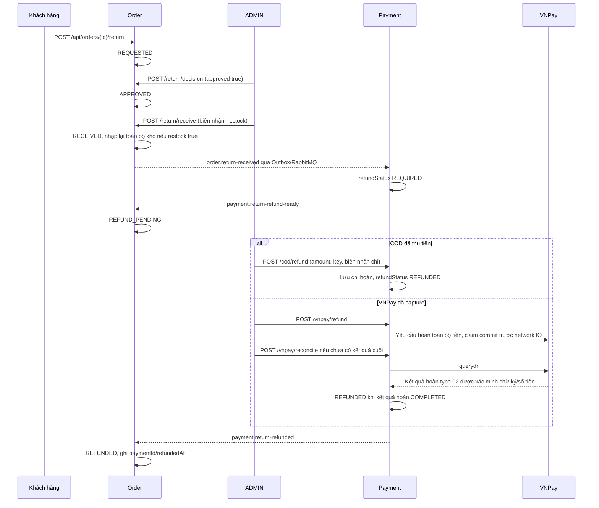

# Trả toàn bộ đơn và hoàn tiền

Hỗ trợ đơn đã COMPLETED, trả toàn bộ sản phẩm và hoàn toàn bộ tổng tiền
snapshot của đơn. Khách không gửi số lượng/tổng hoàn trong yêu cầu trả;
server lấy dữ liệu gốc. Không trả một phần, không thu phí trả hàng hoặc
áp dụng thời hạn tự động trong phiên bản này. ADMIN quyết định theo lý do
và chính sách vận hành. Mỗi đơn có một hồ sơ trả hàng; REJECTED là kết quả
cuối cùng của hồ sơ, không tự mở yêu cầu khác cho cùng đơn.

Trạng thái hồ sơ tách khỏi lịch sử giao hàng: Order vẫn COMPLETED; truy vấn
`GET /api/orders/{id}/return` để biết tiến trình và số tiền đã hoàn.



## API

| API | Quyền | Body / kết quả |
|---|---|---|
| POST `/api/orders/{id}/return` | Chủ đơn hoặc ADMIN | idempotencyKey, reason; tạo/replay hồ sơ 200 |
| GET `/api/orders/{id}/return` | Chủ đơn hoặc ADMIN | Trạng thái, amount, lý do, audit duyệt/nhận/hoàn |
| POST `/api/orders/{id}/return/decision` | ADMIN | approved boolean, note; APPROVED hoặc REJECTED |
| POST `/api/orders/{id}/return/receive` | ADMIN | warehouseReceipt, restock boolean; nhận toàn bộ hàng |
| POST `/api/payments/{id}/cod/refund` | ADMIN | amount, idempotencyKey, receiptNumber; biên nhận chi hoàn |
| GET `/api/payments/{id}/cod/refund` | Chủ payment hoặc ADMIN | Số tiền, số biên nhận, refundedBy, refundedAt |
| POST `/api/payments/{id}/vnpay/refund` | ADMIN | Không body; dùng endpoint refund hiện có |
| POST `/api/payments/{id}/vnpay/reconcile` | ADMIN | Không body; dùng endpoint đối soát hiện có |
| POST `/api/payments/{id}/simulate-refund` | ADMIN | Không body; chỉ payment ONLINE mô phỏng, không có VNPay attempt |

Các API đi qua Gateway. USER khác nhận 404; thiếu JWT 401; sai quyền 403;
body thiếu/sai 400; sai trạng thái, số tiền hoặc replay khác nội dung 409.
Người dùng không thể tự duyệt, tự nhận hàng hoặc tự xác nhận hoàn tiền.

```json
{"idempotencyKey":"return-order-001","reason":"Tra lai toan bo don"}
```

```json
{"approved":true,"note":"Chap nhan tra lai toan bo hang"}
```

```json
{"warehouseReceipt":"WAREHOUSE-RETURN-001","restock":true}
```

```json
{"amount":250000.00,"idempotencyKey":"cash-refund-001","receiptNumber":"CASH-REFUND-001"}
```

## Quy tắc tiền và kho

- Yêu cầu/duyệt chưa thay đổi kho hoặc mở hoàn tiền. Receive chỉ được sau
  APPROVED; ghi người nhận, thời gian và biên nhận kho. Hàng hỏng/không bán
  được dùng restock false. Restock true tăng available của mọi item một
  lần, không thay reserved. Nếu một item không thêm được hoặc receipt
  đã dùng, toàn bộ transaction rollback, hồ sơ vẫn APPROVED.
- Sau receive, Payment xử lý bất đồng bộ rồi mới cho hoàn. Poll payment
  `refundStatus=REQUIRED`; gọi hoàn trước acknowledgement nhận 409. Order
  có thể còn REFUND_PENDING ngay sau khi Payment đã hoàn; poll hồ sơ trả.
- COD chỉ hoàn sau khi đã thu đủ tiền và nhận lại hàng. Amount phải bằng
  payment.amount. ADMIN xác nhận đã thực sự chi tiền cho chủ payment; API
  lưu biên nhận, không tự chuyển tiền hoặc xác minh tiền mặt thực tế.
- Biên nhận chi/key là duy nhất trong Payment. Replay cùng payment/key/
  biên nhận/số tiền/người chi trả cùng kết quả; đổi nội dung nhận 409.
  Biên nhận kho cũng duy nhất; quyết định/receive replay phải cùng nội dung
  và ADMIN đã ghi ban đầu. Kho và Outbox không thay đổi thêm khi replay.
- Payment giữ SUCCESS của capture gốc và completedAt gốc; refundStatus
  chuyển NONE → REQUIRED → REFUNDED. Lịch sử thu COD không bị ghi đè.
- VNPay dùng cơ chế claim/refund/querydr hiện có. Timeout/chữ ký sai/số
  tiền sai/giao dịch type 01 không chứng minh đã hoàn; hồ sơ tiếp tục chờ.
  UNKNOWN/PROCESSING/REJECTED không đánh dấu hoàn tất. Không gửi lại POST
  refund khi kết quả chưa rõ; đối soát hoặc xử lý với nhà cung cấp theo
  runbook VNPay. Test mô phỏng không được bypass COD hoặc VNPay capture.

## Lưu trữ và vận hành

Order có order_returns; Payment có returned_orders/cash_refunds. Các event
giữ CommerceEvent riêng từng service; không thêm shared module. Queue mới
payment.return-received.q và order.return-result.q có DLQ/policy riêng.
Inbox chống gửi lại; parent/payment row lock khóa các bước đồng thời;
thay đổi kho, hồ sơ, biên nhận và Outbox commit trong cùng transaction.
Order chấp nhận completion đến trước ready mà không lùi REFUNDED.

Migration mới: Order 005-full-order-returns.sql và Payment
003-full-order-refunds.sql. Migration Order 006 và Payment 004 bảo đảm FK/
CHECK của hồ sơ/biên nhận khi Hibernate đã tạo bảng trên database CI mới.
Giữ nguyên file đã checksum và dữ liệu cũ;
COD CHECK v2 cho phép trạng thái refund của payment đã thu tiền. Deploy
topology/schema và Payment trước Order. Rollback cần giữ consumer đọc
được event/hồ sơ đã tạo; không hạ về phiên bản chưa hỗ trợ returns khi
đang xử lý hồ sơ. Không có tích hợp hãng vận chuyển hay email trả hàng mới;
khách theo dõi trạng thái bằng GET hồ sơ. Notification giao hàng/thu tiền
trước đó giữ nguyên.

Java tests phủ quyền, replay, số tiền, hàng hỏng, rollback nhiều sản phẩm,
thu/chi hoàn đồng thời, VNPay uncertain/signed ledger và recovery. Live
fixture dùng PostgreSQL, RabbitMQ, Gateway và HTTP provider fixture đã ký;
không xác nhận giao dịch ngân hàng thật. Xem [nhật ký](commits-and-deployments.md).
